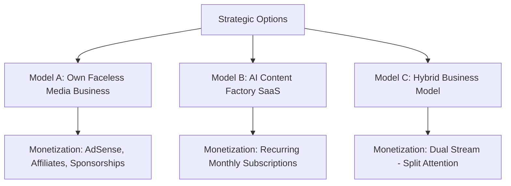

# 03. Business Model Comparison & Niche Selection

**Auditor**: Principal Startup Product Strategist & Business Profitability Auditor  
**Evaluation Scope**: Business Model Validation (Phase 2) & Market Niche Scoring (Phase 4)  
**Objective**: Identify the most profitable, sustainable, and founder-compatible commercial path.  

---

## 1. Business Model Evaluation

We evaluate three potential commercial directions independently against the founder's explicit constraints:
- Professional software engineering background.
- 100% online operation.
- No personal face, real name, or public exposure.
- Low initial capital investment.
- Minimal recurring infrastructure expenses.
- Recurring revenue and scalable distribution.
- No door-to-door sales or manual freelancing retainers.

---

### 1.1 In-Depth Comparison Matrix Across 12 Critical Dimensions

| Evaluation Dimension | Model A: Own Faceless Media Business (Internal Operator) | Model B: AI Content Factory SaaS (B2B Software Vendor) | Model C: Hybrid Business (Operate Channels + Sell Software) |
|---|---|---|---|
| **1. Target Customer** | Mass social media audience (YouTube, Instagram, TikTok consumers). | Content creators, solo marketers, small business owners, agencies. | Both consumers (viewers) and B2B software buyers. |
| **2. Actual Problem Solved** | Boredom, curiosity, basic entertainment or high-level information. | High cost of video editors ($1,000–$3,000/mo) and time consumed in video editing (10–20 hrs/week). | Solving creator workflow while running content experiments. |
| **3. Willingness to Pay** | **Zero directly from viewers.** Monetization is indirect via third-party advertisers or affiliate buyers. | **High.** Businesses and active creators gladly pay ₹999 to ₹2,999 ($15–$50/mo) to replace video agencies. | High for SaaS; indirect for media. |
| **4. Market Demand** | Infinite demand for entertaining video, but saturation of low-quality AI content is severe. | Rapidly expanding demand for fast, automated video production tools. | High in both, but split across two entirely different markets. |
| **5. Competitive Pressure** | **Extreme.** Millions of anonymous channels uploading identical AI shorts daily. | Moderate in niche verticals (high in generic text-to-video, low in regional B2B). | Extreme in media, moderate in SaaS. |
| **6. Differentiation** | Difficult to differentiate faceless vertical shorts from competitors without unique IP or voice. | High differentiation possible through specialized workflows, regional languages, or compliance rules. | High technological leverage, but brand identity is confused. |
| **7. Customer Acquisition** | Algorithmic lottery (YouTube/TikTok recommendation algorithms). Vulnerable to sudden shadowbans. | Search SEO, YouTube product tutorials, creator directories, word-of-mouth, affiliate partners. | Must run two completely separate acquisition funnels. |
| **8. Monetization Potential** | **Low to Moderate.** In India, 1M Shorts views = ₹800–₹3,500 ($10–$42). Long-form is better, but harder to automate. | **High & Predictable.** 100 customers @ ₹999/mo = ₹1,00,000/mo ($1,200/mo) high-margin MRR. | High theoretical ceiling, but high operational drag. |
| **9. Operational Complexity** | High daily content churning, topic trend-jacking, community management, thumbnail testing. | Moderate engineering maintenance, customer support, and feature iterations. | **Catastrophic for a solo founder.** Managing media brands AND SaaS infrastructure causes burnout. |
| **10. Recurring Expenses** | Low API costs if using local FFmpeg, but high opportunity cost of unmonetized time. | Low hosting costs (VPS + SQLite + Pay-per-use LLM APIs = <$50/mo base). | Compounded costs of both video rendering infrastructure and customer-facing multi-tenant servers. |
| **11. Time to First Revenue** | **6 to 12 months minimum.** Must cross YPP thresholds (1,000 subs + 10M Shorts views in 90 days). | **15 to 30 days.** Can sell lifetime deals or monthly beta access immediately upon launch. | 3 to 6 months. |
| **12. Fatal Risks & Barriers** | **Platform Demonetization.** YouTube's "Inauthentic Content" policy can wipe out revenue overnight. | Customer churn if videos do not generate results for the buyer. | Context-switching fatigue leading to failure in both directions. |

---

### 1.2 Strategic Model Verdict

- **Model A (Own Faceless Media Business)**: **REJECTED AS PRIMARY PATH.**  
  *Why*: Relying exclusively on YouTube Shorts AdSense in India (where RPM is ₹0.80–₹3.50 per 1k views) requires tens of millions of views monthly just to pay rent. Furthermore, YouTube's 2024/2025 aggressive crackdown on "Inauthentic Content" creates catastrophic existential risk for an automated faceless channel.
- **Model C (Hybrid Business)**: **REJECTED.**  
  *Why*: Running media channels requires full-time creative vigilance, script testing, and trend-surfing. Building a software platform requires architectural rigor, bug fixing, and customer support. For a solo founder with limited time, attempting both simultaneously guarantees mediocrity in both.
- **Model B (AI Content Factory SaaS / Micro-SaaS)**: **RECOMMENDED PRIMARY DIRECTION.**  
  *Why*: Selling the software delivers immediate B2B recurring revenue, high margins (>80%), zero dependence on erratic social media algorithms for monetization, and direct control over customer relationships and cash flow.

---

## 2. Niche Opportunity Evaluation Matrix

A generic "AI Content Factory" will fail against venture-funded giants like InVideo, CapCut, or Canva. To dominate as a solo founder, the product must capture an **underserved, high-intent vertical niche**.

We evaluate 10 distinct market niches across 7 weighted criteria:
1. **Market Demand (20%)**: Existing search volume and active addressable audience.
2. **Willingness to Pay (20%)**: Budget availability and business ROI for the end user.
3. **Competition & Differentiation (15%)**: Absence of entrenched dominant players.
4. **Revenue Potential (15%)**: Potential to generate ₹1,00,000 to ₹3,00,000/mo ($1,200–$3,500 MRR).
5. **Low Operating Costs (10%)**: Ability to deliver value with minimal GPU/API expenditure.
6. **Automation Potential (10%)**: Extent to which the workflow can run with minimal human manual intervention.
7. **Ease of Customer Acquisition (10%)**: Feasibility of acquiring customers without personal branding or door-to-door sales.

### Niche Scoring Table (Scores out of 10)

| Niche Candidate | Market Demand (20%) | Willingness to Pay (20%) | Differentiation (15%) | Revenue Potential (15%) | Low Operating Costs (10%) | Automation Potential (10%) | Ease of Acquisition (10%) | **Weighted Total Score** |
|---|:---:|:---:|:---:|:---:|:---:|:---:|:---:|:---:|
| **1. Regional Indian Language (Hindi/Bengali) Business & Financial Explainer Automation** | 9.0 | 9.0 | 9.5 | 9.0 | 8.5 | 8.5 | 8.5 | **8.98 / 10** |
| **2. B2B / SaaS Micro-Explainer & Product Changelog Video Engine** | 8.0 | 9.5 | 8.5 | 8.5 | 8.5 | 8.0 | 8.0 | **8.48 / 10** |
| **3. Documentation-to-Shorts Technical Educator Pipeline** | 7.5 | 8.5 | 9.0 | 8.0 | 9.0 | 8.5 | 8.5 | **8.35 / 10** |
| **4. E-commerce / D2C Automated Product Video Factory** | 9.0 | 8.5 | 6.5 | 8.5 | 7.0 | 7.5 | 7.5 | **7.98 / 10** |
| **5. Kids Moral Storytelling & Animated Rhymes (Regional)** | 8.5 | 6.0 | 7.0 | 7.0 | 6.5 | 7.0 | 7.5 | **7.15 / 10** |
| **6. Real Estate & Architectural Property Visual Shorts** | 7.0 | 8.5 | 6.5 | 7.5 | 6.0 | 6.5 | 6.0 | **7.03 / 10** |
| **7. Faceless Glamour & Dance Media (Current Codebase Focus)** | 6.5 | 2.5 | 4.0 | 4.0 | 5.0 | 7.0 | 5.0 | **4.68 / 10** |
| **8. Generic Reddit Stories & Gaming Background Clips** | 7.0 | 3.0 | 2.0 | 3.5 | 8.5 | 9.5 | 5.5 | **4.93 / 10** |
| **9. Daily Motivational / Stoic Philosophy Shorts** | 7.5 | 3.0 | 2.5 | 3.5 | 8.5 | 9.0 | 5.0 | **5.08 / 10** |
| **10. Celebrity Gossip & Entertainment News Loops** | 8.0 | 3.5 | 3.0 | 4.0 | 7.0 | 8.0 | 6.0 | **5.45 / 10** |

---

## 3. Deep Dive into the Top Three Opportunities

### 🥇 Opportunity #1 (WINNER): Regional Indian (Hindi & Bengali) Financial & Business Explainer SaaS
- **Target Audience**: Financial advisors (MFDs, RIAs), tax consultants (CAs), regional insurance agents, real estate brokers, and educational creators across India.
- **Problem Solved**: These professionals know that vertical video (Reels, Shorts) is the #1 way to acquire clients today. However:
  1. They are camera-shy and hate appearing on video.
  2. Video agencies charge ₹3,000–₹10,000 per video.
  3. Western AI tools (InVideo, Synthesia) speak robotic, unnatural translated English or formal Hindi, with zero cultural nuance or relevant Indian visual templates.
- **Solution**: A specialized web platform where a user inputs a financial/business topic (e.g., "Mutual Fund vs Fixed Deposit in 2026", "Section 80C Tax Deductions", "SIP Compounding Secrets") and receives an authentic, culturally tuned Hindi or Bengali vertical video with natural conversational voice, animated infographic data cards, clear Hindi/Bengali typography, and regulatory disclaimer watermarks.
- **Why It Wins**:
  - High willingness to pay: A single new client acquired from a Reel pays for an entire year of software subscription.
  - Defensible differentiation: Global AI tools will never deeply localize for tier-2/tier-3 Indian regional finance and business nuances.
  - Zero camera requirement for the user.

### 🥈 Opportunity #2: B2B Micro-Explainer & Changelog Video Engine for Software Founders
- **Target Audience**: Indie hackers, micro-SaaS founders, open-source maintainers, and developer-tool startups.
- **Problem Solved**: Developers build features continuously but fail at marketing them. Producing a professional 45-second product teaser for Twitter/X and LinkedIn takes hours in After Effects or CapCut.
- **Solution**: Ingests release notes, GitHub markdown, or URL screenshots, and automatically renders a sleek developer-aesthetic video (terminal styling, product mockups, smooth typography, synthesized tech voiceover).
- **Why It Ranks #2**: Strong willingness to pay ($29–$49/mo), but smaller total addressable market than regional Indian business owners.

### 🥉 Opportunity #3: Documentation-to-Shorts Pipeline for Knowledge Creators
- **Target Audience**: Technical bloggers, Substack newsletter authors, book summary curators, and online educators.
- **Problem Solved**: Text-heavy creators struggle to cross-promote their written knowledge into short-form algorithmic video feeds.
- **Solution**: Automatically parses long-form articles, extracts the 5 most actionable insights, pairs them with conceptual graphics, and outputs structured educational shorts.
- **Why It Ranks #3**: Solid demand, but educational creators have higher churn and lower budgets than B2B service professionals.

---

## 4. The Fatal Verdict on the Current "Luxury Dancer" Niche

The existing codebase's hyper-focus on "Luxury Dancer Personas" (Priya Desi Siren, Elena Crimson Siren, silk sarees, and seductive stage movements) scores an abysmal **4.68 / 10** on the commercial evaluation matrix.

### Why It Must Be Abandoned Immediately:
1. **Zero B2B Willingness to Pay**: No reputable business, agency, or paying creator will subscribe to a software platform built around seductive virtual dancers.
2. **Platform Policy Suicide**: Social media algorithms (YouTube, Meta, TikTok) heavily restrict the monetization and distribution of content bordering on suggestive, sexually objectified, or non-educational synthetic personas.
3. **Audience Demographics**: The viewers attracted to anonymous virtual dancers represent the lowest-converting, lowest-RPM demographic on the internet. They do not buy SaaS subscriptions, digital products, or high-ticket affiliate offers.
4. **Massive Operational Drag**: Trying to make dancing look fluid requires heavy video diffusion models (Stable Video Diffusion, MimicMotion) on high-end GPUs, resulting in agonizing render times (10+ minutes per short) and high cloud bills, destroying unit economics.

---

## 5. Final Strategic Direction

**We recommend committing 100% of product development to Opportunity #1**:  
**"Vani Studio" (or "Auravo B2B") — An Automated Regional Language (Hindi/Bengali/English) Video Engine for Indian Financial & Business Professionals.**

This direction combines:
- A large, affluent target market with real marketing budgets.
- Massive organic distribution via LinkedIn, Instagram, and YouTube.
- Simple, high-speed procedural rendering (infographics, dynamic typography, split-screen data) that runs on cheap CPU servers without expensive neural video GPUs.
- Predictable recurring B2B subscriptions (₹999 to ₹1,999/month).

