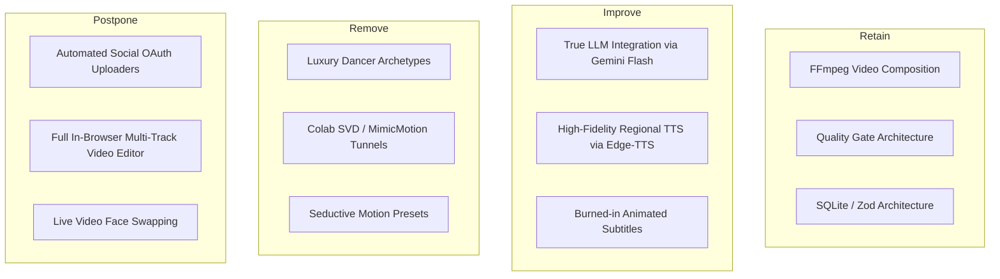

# 04. Product Gaps & Feature Prioritization Matrix

**Product Vision**: Regional Indian B2B Video Automation Platform (Hindi / Bengali / English)  
**Target Profile**: Financial Advisors, Tax Professionals, Small Business Owners & Educators  
**Auditor**: Principal Startup Product Strategist & Senior Systems Architect  

---

## 1. Feature Rationalization: Retain, Improve, Remove, Postpone

### 1.1 Features to Retain
1. **FFmpeg Core Composition Engine (`server/providers/video.ts`)**: The underlying mechanics of concatenating clips, applying Ken Burns zoom/pan filters, and mixing voice audio with background music work smoothly, cost ₹0, and run locally in seconds.
2. **Quality Gate Framework (`server/providers/quality_gate.ts`)**: The safety, copyright, and originality verification pipeline is a major enterprise asset and should be re-targeted to financial compliance (e.g., checking for mandatory SEBI/IRDAI disclaimers).
3. **Lightweight Backend Architecture (`server/app.ts`, `server/db.ts`)**: Express + Zod + SQLite represents an extraordinarily lean, fast operational base with near-zero infrastructure cost.

### 1.2 Features to Improve
1. **Scripting Pipeline (`server/providers/llm.ts`)**: Transition from hardcoded string templates to real LLM generation (using Google Gemini 1.5/2.0 Flash or Groq Llama 3) with prompt templates optimized for 45-second regional financial and business explainers.
2. **TTS Narration (`server/providers/tts.ts`)**: Replace macOS `say` and dummy noise with Microsoft Edge-TTS (free, high-quality, authentic Indian English, Hindi `hi-IN-MadhurNeural`/`hi-IN-SwaraNeural`, and Bengali `bn-IN-BashkarNeural`/`bn-IN-TanishaaNeural`).
3. **Animated Subtitles**: Upgrade the standalone `.srt` generator into burned-in, animated word-level captions directly rendered onto the video using FFmpeg drawtext or libass subtitles filter.

### 1.3 Features to Remove / Purge Immediately
1. **All 7 Luxury Dancer Archetypes**: Completely delete Priya Desi Siren, Elena Crimson Siren, and all associated sexy/glamour prompts, portraits, and costume descriptions from `server/content_engine.ts` and `web/main.tsx`.
2. **Brittle Colab GPU Diffusion Tunnels (`scripts/colab_dance_diffusion_server.py`)**: Eliminate the fake zero-cost Colab tunnel server. It is unstable, violates Colab TOS for production backends, and adds massive latency.
3. **Bollywood Rain / Seductive Dance Beat Mixing**: Replace `bollywood_monsoon_beat.mp3` with a curated library of clean, professional, corporate/documentary background tracks.

### 1.4 Features to Postpone
1. **Direct Social Media OAuth Publishing (YouTube / Meta / TikTok APIs)**: Postpone to P2. The OAuth verification process with Google and Meta takes 4–8 weeks of enterprise review. In the MVP phase, users prefer downloading the 1080x1920 MP4 file to their phone and uploading manually via native apps (which also gives better reach due to native platform posting).
2. **In-Browser Video Timeline Editor**: Postpone to P3. Do not try to rebuild CapCut in the browser. Users want a "topic in, video out" experience.

---

## 2. Feature Prioritization Framework (P0, P1, P2, P3)

Prioritization Categories:
- **P0**: Essential for Commercial Launch (Must have before taking ₹1).
- **P1**: High-Value Improvements (Increases conversion and satisfaction).
- **P2**: Growth & Retention Features (Virality, referrals, team plans).
- **P3**: Future Enhancements (Advanced scale).

---

### Detailed Specification for Every Prioritized Feature

#### Feature 1: Real Generative AI Script Engine (Hindi, Bengali & English)
- **Business Problem**: Current scripts are hardcoded templates. Users need authentic, highly accurate financial and business scripts tailored to their specific topic.
- **Target User**: Financial advisors, Chartered Accountants, business owners.
- **Expected Business Value**: Transforms the tool from a mock prototype into a genuine utility that saves 2 hours of writing per video.
- **Technical Complexity**: Low (REST API integration).
- **Estimated Development Effort**: 2 days.
- **Recurring Operating Cost**: Extremely low (<₹0.10 / $0.001 per script using Gemini 1.5 Flash).
- **Priority**: **P0**
- **Success Metric**: 90%+ acceptance rate of generated scripts without manual rewriting.

#### Feature 2: High-Quality Regional Neural TTS (Hindi, Bengali & Indian English)
- **Business Problem**: macOS `say` voice sounds robotic, has no native Hindi/Bengali phonetics, and fails on Linux/Docker servers.
- **Target User**: Indian vernacular content creators.
- **Expected Business Value**: Videos sound like real human domain experts, driving high viewer retention on Reels and Shorts.
- **Technical Complexity**: Low-to-Medium (Integrating Microsoft Edge-TTS via python or node-edge-tts).
- **Estimated Development Effort**: 2 days.
- **Recurring Operating Cost**: **₹0** (Edge-TTS has zero API fee and runs via standard edge endpoints).
- **Priority**: **P0**
- **Success Metric**: 100% natural pronunciation of regional financial terms (e.g., *Nivesh*, *Byaaj*, *Karch*, *Munafa*).

#### Feature 3: Dynamic Infographic & Data-Card Visual Generator
- **Business Problem**: Replacing stock dancer photos with visually compelling financial charts, comparison tables, and key takeaways.
- **Target User**: Professionals explaining concepts like "SIP vs RD" or "New Tax Regime vs Old Tax Regime".
- **Expected Business Value**: Eliminates the need for real video footage while delivering high-information density.
- **Technical Complexity**: Medium (Rendering clean SVG graphics with `@resvg/resvg-js` featuring dynamic numbers, pie charts, and icons).
- **Estimated Development Effort**: 4 days.
- **Recurring Operating Cost**: **₹0** (Rendered locally on CPU).
- **Priority**: **P0**
- **Success Metric**: Video watch completion rate >65% on Instagram Reels.

#### Feature 4: Burned-in High-Impact Animated Subtitles
- **Business Problem**: 70%+ of mobile social media users watch videos on mute. Without on-screen subtitles, viewers scroll past within 2 seconds.
- **Target User**: All short-form video viewers.
- **Expected Business Value**: Direct increase in watch time and client inbound leads.
- **Technical Complexity**: Medium (FFmpeg ASS subtitle filter with word-by-word highlight colors in yellow/cyan).
- **Estimated Development Effort**: 3 days.
- **Recurring Operating Cost**: **₹0** (Local FFmpeg processing).
- **Priority**: **P0**
- **Success Metric**: Subtitles rendered with 100% synchronization and clear readability on mobile screens.

#### Feature 5: Multi-Tenant Architecture & Self-Service User Accounts
- **Business Problem**: Existing codebase restricts registration to a single user (`SELECT COUNT(*) FROM users > 0 -> 403`).
- **Target User**: Any paying customer registering on the website.
- **Expected Business Value**: Unlocks commercialization. Multiple users can sign up, create brands, and keep their assets isolated.
- **Technical Complexity**: Low-to-Medium (Remove single-user gate, add `tenantId` / `userId` indexing, enforce strict WHERE clauses).
- **Estimated Development Effort**: 2 days.
- **Recurring Operating Cost**: **₹0**.
- **Priority**: **P0**
- **Success Metric**: 100% data isolation between distinct customer accounts verified by automated tests.

#### Feature 6: Indian Payment Gateway & Subscription Lifecycle (Razorpay)
- **Business Problem**: No payment processing exists in the repository.
- **Target User**: Paying subscribers in India.
- **Expected Business Value**: Enables automated recurring billing (UPI AutoPay, Credit Cards, NetBanking).
- **Technical Complexity**: Medium (Razorpay Subscriptions API + Webhook listener for subscription activation, renewal, and cancellation).
- **Estimated Development Effort**: 3 days.
- **Recurring Operating Cost**: 2% + 18% GST per transaction (standard gateway fee).
- **Priority**: **P0**
- **Success Metric**: Zero-friction checkout with instantaneous account tier upgrading upon payment success.

#### Feature 7: Financial Compliance & Disclaimer Watermark Engine
- **Business Problem**: Financial professionals face strict regulatory penalties (SEBI / RBI / IRDAI) if they post investment content without mandatory disclaimers.
- **Target User**: Registered investment advisors, mutual fund distributors, chartered accountants.
- **Expected Business Value**: **Massive competitive advantage.** Competitors (InVideo, CapCut) offer no compliance tools. This feature turns our product into an essential enterprise compliance tool.
- **Technical Complexity**: Low (Enforces mandatory disclaimer banner at bottom of video: *"Mutual fund investments are subject to market risks..."*).
- **Estimated Development Effort**: 1 day.
- **Recurring Operating Cost**: **₹0**.
- **Priority**: **P1**
- **Success Metric**: 100% of generated financial videos pass regulatory compliance checks.

#### Feature 8: Background Asynchronous Video Rendering Queue
- **Business Problem**: Rendering FFmpeg videos synchronously inside an Express HTTP route blocks the Node server process when multiple users render simultaneously.
- **Target User**: All users on the platform.
- **Expected Business Value**: Prevents server timeouts and crashes under load.
- **Technical Complexity**: Medium (Lightweight SQLite-backed job queue or Redis/BullMQ worker).
- **Estimated Development Effort**: 3 days.
- **Recurring Operating Cost**: $0 if SQLite job queue; ~$5/mo if Redis container.
- **Priority**: **P1**
- **Success Metric**: 0% dropped rendering requests with real-time job progress polling (0%–100%).

#### Feature 9: Programmatic Watermarked Video Previews (Product-Led Growth)
- **Business Problem**: Prospects want to see their video before entering credit card details.
- **Target User**: First-time website visitors.
- **Expected Business Value**: Dramatically lowers customer acquisition friction. Free users generate a video with a prominent watermark; upgrading removes the watermark.
- **Technical Complexity**: Low (Overlay semi-transparent SVG watermark via FFmpeg).
- **Estimated Development Effort**: 1 day.
- **Recurring Operating Cost**: Fraction of a cent in CPU compute.
- **Priority**: **P1**
- **Success Metric**: Free-to-paid conversion rate >5%.

#### Feature 10: One-Click Direct Social Media Publishing (YouTube & Meta)
- **Business Problem**: Users have to download the video to their computer and upload it manually.
- **Target User**: Power creators and busy professionals.
- **Expected Business Value**: Increases monthly retention and reduces user churn.
- **Technical Complexity**: High (OAuth2 token lifecycle, YouTube Data API quota management, Meta Graph API permissions review).
- **Estimated Development Effort**: 8–10 days.
- **Recurring Operating Cost**: Free tier APIs, but high maintenance overhead.
- **Priority**: **P2**
- **Success Metric**: 50%+ of monthly videos published directly through the platform.

---

## 3. Prioritization Summary Table

| Feature Name | Priority | Target Timeline | Impact on Revenue | Complexity |
|---|:---:|:---:|:---:|:---:|
| Multi-Tenant Auth & User Isolation | **P0** | Week 1 | Enables All Revenue | Low-Med |
| Real Regional LLM Scripting (Gemini) | **P0** | Week 1 | Product Viability | Low |
| Natural Regional TTS (Edge-TTS) | **P0** | Week 1 | Core Retention | Low |
| Financial Infographic Visual Engine | **P0** | Week 2 | Core Value | Medium |
| Burned-in Animated Subtitles | **P0** | Week 2 | Video Quality | Medium |
| Razorpay Subscription Billing | **P0** | Week 2 | First Cash Flow | Medium |
| SEBI/IRDAI Compliance & Disclaimers | **P1** | Week 3 | Competitive Moat | Low |
| SQLite/Redis Job Queue for FFmpeg | **P1** | Week 3 | Server Stability | Medium |
| Watermarked Preview (PLG Funnel) | **P1** | Week 4 | Customer Acquisition | Low |
| One-Click Social Publishing (OAuth) | **P2** | Month 2 | Long-term Retention | High |
| Custom Brand Watermark & Fonts | **P2** | Month 2 | Upsell to Pro Tier | Low-Med |
| In-Browser Timeline Trimmer | **P3** | Month 3+ | Feature Parity | High |

