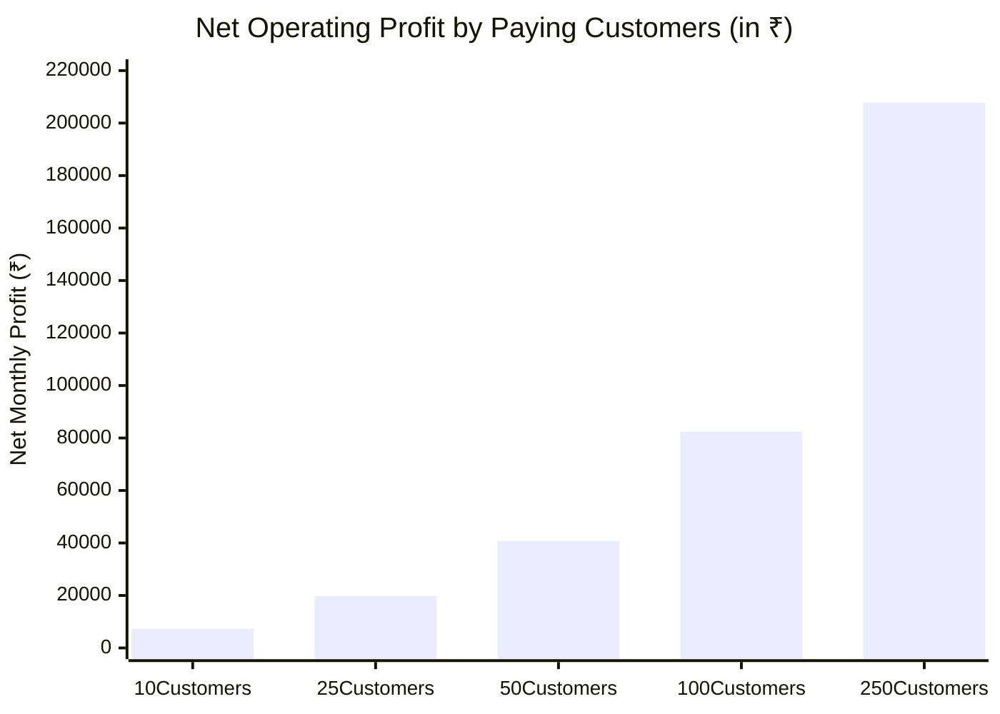

# 05. Unit Economics, API Cost Optimization & Profitability Models

**Auditor**: Principal Startup Financial Analyst & AI Cost Optimization Specialist  
**Currency Standard**: Indian Rupee (₹) & US Dollar ($ at ₹86 per USD)  
**Evaluation Scope**: AI Automation Cost Optimization (Phase 6) & Unit Economics Modeling (Phase 7)  

---

## 1. Technical Cost Audit & Production Economics

### 1.1 Commercial Cloud APIs vs. Lean Optimized Architecture

Many AI media startups fail because they use expensive, unoptimized cloud APIs for every step of production.

| Production Step | Naive / Expensive Cloud Stack | Cost per 45s Short Video | Lean Optimized Stack (Recommended) | Cost per 45s Short Video | Cost Reduction Factor |
|---|---|---|---|---|---|
| **1. Script Generation** | OpenAI GPT-4o (~1,500 tokens input/output) | ₹2.50 ($0.030) | **Google Gemini 1.5 Flash / Groq Llama 3 8B** (~1,500 tokens) | **₹0.08** ($0.001) | **30x cheaper** |
| **2. Voice Narration (TTS)** | ElevenLabs Pro Tier (~120 words / 45s audio) | ₹8.50 ($0.100) | **Microsoft Edge-TTS / Kokoro Neural TTS** | **₹0.00** ($0.000) | **100% Free** |
| **3. Visuals / B-Roll** | Midjourney / DALL-E 3 (5 scenes @ $0.04/img) | ₹17.00 ($0.200) | **Procedural SVG Infographics + Curated CC0 Financial B-Roll** | **₹0.00** ($0.000) | **100% Free** |
| **4. Speech Alignment / Subs** | Deepgram / Whisper API ($0.006/min) | ₹0.50 ($0.006) | **Local FFmpeg Timed Subtitles (ass/srt)** | **₹0.00** ($0.000) | **100% Free** |
| **5. Video Rendering** | Shotstack / Cloudinary / Remotion Cloud | ₹12.00 ($0.140) | **Local CPU FFmpeg Rendering on VPS ($6/mo Hetzner)** | **₹0.15** ($0.002) | **80x cheaper** |
| **Total Production Cost per Video** | **Commercial API Stack** | **₹40.50 ($0.47)** | **Lean Architecture Stack** | **₹0.23 ($0.0027)** | **176x Cheaper!** |

---

### 1.2 Scaling Production Volume: Lean Operating Costs

Under our recommended architecture (Gemini 1.5 Flash + Edge-TTS + Procedural SVG + Hetzner CPU FFmpeg):

| Metric | 1 Short Video | 10 Short Videos | 30 Short Videos (1 Month of Daily Content) | 100 Short Videos (Heavy Creator / Agency) |
|---|:---:|:---:|:---:|:---:|
| **LLM Scripting (Gemini Flash)** | ₹0.08 | ₹0.80 | ₹2.40 | ₹8.00 |
| **Voice Synthesis (Edge-TTS)** | ₹0.00 | ₹0.00 | ₹0.00 | ₹0.00 |
| **Visual Composition (resvg)** | ₹0.00 | ₹0.00 | ₹0.00 | ₹0.00 |
| **FFmpeg CPU Compute** | ₹0.15 | ₹1.50 | ₹4.50 | ₹15.00 |
| **Object Storage (Cloudflare R2)** | ₹0.02 | ₹0.20 | ₹0.60 | ₹2.00 |
| **Total Cost per Batch** | **₹0.25** | **₹2.50** | **₹7.50** | **₹25.00** |
| **Total Cost in USD** | **$0.003** | **$0.029** | **$0.087** | **$0.29** |

> **Key Financial Takeaway**: The marginal cost of producing a full, high-definition 45-second video is **less than 25 paise (₹0.25 / $0.003)**! This gives the SaaS business an astronomical gross margin of **99.5%** on video generation.

---

## 2. SaaS Subscription Modeling & Unit Economics

We evaluate three monthly subscription tiers for the regional business explainer platform:
- **Starter Tier (₹499 / $6 per month)**: 15 videos/month (suitable for casual creators / individual insurance agents).
- **Professional Tier (₹999 / $12 per month)**: 45 videos/month (daily posting for active financial advisors & CAs).
- **Agency / Growth Tier (₹1,999 / $24 per month)**: 120 videos/month + custom branding + SEBI compliance watermarks.

### 2.1 Fixed & Variable Monthly Cost Structure

1. **Fixed Infrastructure Costs**:
   - Web & API Server: ₹500/mo ($6/mo on Hetzner Cloud CPX21, 3 vCPU, 4GB RAM).
   - Domain, DNS & SSL: ₹100/mo ($1.20/mo amortized).
   - Transactional Email (Resend Free Tier up to 3,000 emails/mo): ₹0/mo.
   - Cloudflare R2 Storage (10GB free tier): ₹0/mo.
   - **Total Fixed Monthly Operating Overhead**: **₹600 / month (~$7 USD)**.
2. **Variable Unit Costs**:
   - Razorpay Payment Gateway Fee: 2% + 18% GST on the fee = **2.36% of gross revenue**.
   - API Generation Cost per Professional subscriber (45 videos): 45 × ₹0.25 = **₹11.25 / subscriber / month**.
   - Blended Customer Support / Compute buffer: **₹20 / subscriber / month**.

---

### 2.2 Financial Projections Across Customer Milestones

We model a realistic blended customer distribution:
- 40% on Starter (₹499/mo)
- 50% on Professional (₹999/mo)
- 10% on Agency (₹1,999/mo)
- **Blended Average Revenue Per User (ARPU)**: **₹899 / month (~$10.50 USD)**.



| Customer Count | Gross Monthly Revenue (₹) | Payment Gateway Fees (2.36%) | API & Infrastructure Costs | Marketing / Organic Buffer | Net Contribution Margin | Net Monthly Profit (₹) | Net Monthly Profit (USD) |
|:---:|:---:|:---:|:---:|:---:|:---:|:---:|:---:|
| **10** | ₹8,990 | ₹212 | ₹800 | ₹600 | 82.0% | **₹7,378** | **$86** |
| **25** | ₹22,475 | ₹530 | ₹1,100 | ₹1,000 | 88.3% | **₹19,845** | **$231** |
| **50** | ₹44,950 | ₹1,061 | ₹1,700 | ₹1,500 | 90.5% | **₹40,689** | **$473** |
| **100** | ₹89,900 | ₹2,122 | ₹2,800 | ₹2,500 | 91.7% | **₹82,478** | **$959** |
| **250** | ₹2,24,750 | ₹5,304 | ₹5,800 | ₹5,000 | 92.8% | **₹2,08,646** | **$2,426** |

### 2.3 Break-Even Analysis
- **Fixed Monthly Operating Costs**: ₹600 (Server) + ₹1,000 (Basic buffer) = ₹1,600.
- **Contribution Margin per Customer**: ₹899 - ₹21 (Gateway) - ₹12 (API) = **₹866**.
- **Break-Even Point**: `₹1,600 / ₹866` = **2 Paying Customers!**
- With just 2 paying customers on the ₹999 tier, all server and operational expenses are 100% covered.

---

## 3. Financial Comparison: Own Media Business vs. SaaS Model

To rigorously test whether operating an owned media channel could be more profitable, we model both paths under realistic market conditions:

### 3.1 Scenario A: Operating an Owned Faceless YouTube Shorts Channel (India Audience)
- **Assumed Monthly Output**: 60 Shorts / month (2 videos per day).
- **Target Audience**: Indian entertainment / dance / general viewers.
- **Monthly Views Achieved**: 5,000,000 views (requires top 1% algorithmic virality).
- **Average Shorts RPM**: ₹2.00 per 1,000 views.
- **AdSense Earnings**: `5,000 × ₹2.00` = **₹10,000 / month ($116 USD)**.
- **Affiliate Sales (1 in 5,000 view conversion @ ₹200 commission)**: `1,000 conversions × ₹200` = ₹2,00,000 (Extremely unrealistic for dance/entertainment shorts; realistic conversion for dance is <1 in 50,000 = ₹20,000).
- **Production Time Required**: 40 hours/month.
- **Downside Risk**: Channel demonetization under YouTube's "Inauthentic Content" policy = **Instant ₹0 revenue**.

### 3.2 Scenario B: Operating a B2B Micro-SaaS (Regional Explainer Video Engine)
- **Paying Customers**: 100 subscribers @ ₹899 ARPU.
- **Gross Revenue**: **₹89,900 / month ($1,045 USD)**.
- **Production Time Required**: 8–10 hours/month of software maintenance and customer support.
- **Downside Risk**: 5–8% monthly churn, easily offset by acquiring 6–10 new customers via SEO and programmatic faceless video tutorials.

```
Financial Comparison Summary:
To earn ₹80,000/month from YouTube Shorts AdSense in India requires 40 MILLION VIEWS every month.
To earn ₹80,000/month from SaaS requires exactly 85 PAYING BUSINESS CUSTOMERS.
```

The commercial superiority of the SaaS model for an independent software engineer is overwhelming.

---

## 4. Sensitivity Analysis: Pessimistic, Base-Case, and Optimistic Scenarios (Month 6)

| Metric | Pessimistic Scenario | Base-Case Scenario | Optimistic Scenario |
|---|---|---|---|
| **Paying Subscribers** | 18 | 65 | 160 |
| **Blended ARPU** | ₹699 (High Starter mix) | ₹899 | ₹1,099 (High Agency mix) |
| **Gross Monthly Revenue** | ₹12,582 | ₹58,435 | ₹1,75,840 |
| **Monthly Churn Rate** | 12.0% | 6.5% | 3.5% |
| **Server & API Costs** | ₹1,200 | ₹2,200 | ₹4,500 |
| **Payment Gateway Fees** | ₹297 | ₹1,379 | ₹4,150 |
| **Marketing Expenses** | ₹1,000 | ₹2,500 | ₹6,000 |
| **Net Operating Profit (₹)** | **₹10,085 / mo** | **₹52,356 / mo** | **₹1,61,190 / mo** |
| **Net Operating Profit (USD)** | **$117 / mo** | **$608 / mo** | **$1,874 / mo** |
| **Founder Time Commitment** | 5 hrs / week | 8 hrs / week | 12 hrs / week |

