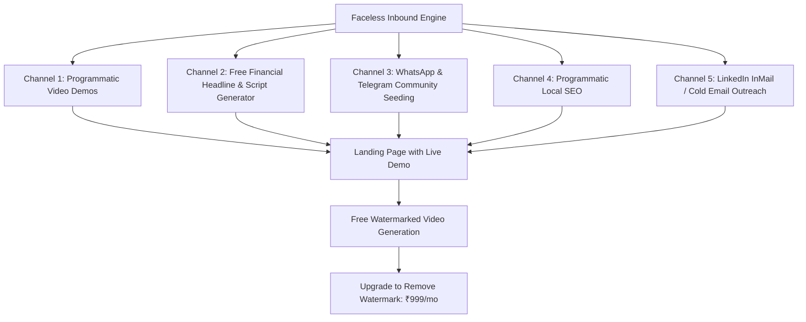

# 07. Final Strategic Decision & Executive Mandate

**Auditor**: Principal Startup Product Strategist, Venture Analyst & Profitability Auditor  
**Scope**: Direct, Uncompromising Strategic Verdict (Phase 11) & Customer Acquisition Strategy (Phase 8)  
**Tone**: Objective, commercially realistic, technically rigorous, financially conservative.  

---

## 1. Direct Answers to the Ten Core Strategic Questions

### 1. Is my current project commercially promising?
**No, not in its current state.**  
The current codebase has wandered into an unviable niche: producing vertical videos featuring virtual luxury dancers ("Priya The Royal Desi Siren", "Elena The Crimson Siren", silk sarees, and seductive stage movements) using deterministic string templates and mock scoring formulas. In its current form, businesses will not touch it, creators will not pay for it, and social media platforms will demonetize it under YouTube's "Inauthentic Content" and sensitive content guidelines.

**HOWEVER, the underlying technological core—the zero-cost FFmpeg composition pipeline, the Quality Gate verification framework, and the lightweight SQLite/Express architecture—is exceptionally promising** if pivoted immediately to an underserved commercial B2B market.

### 2. Is the current product solving a problem people will pay for?
**No.** Nobody pays money for a generator that only produces 5-beat scripted dance sequences over static stock portraits.  
What people **will pay for** is solving the expensive, agonizing problem of **video production for non-video professionals**: financial advisors, tax consultants, and small business educators who need client-generating Reels and Shorts in Hindi and Bengali, but who are camera-shy, cannot edit video, and cannot afford a ₹15,000/month video agency retainer.

### 3. Should I continue the existing direction, pivot, simplify or abandon certain modules?
**Execute an immediate, radical PIVOT.**
- **Abandon**: The entire dancer persona system, seductive dance motion presets, and brittle Google Colab SVD tunnels.
- **Simplify**: Remove simulated social publishing; focus on delivering pristine 1080x1920 MP4 video downloads with burned-in subtitles.
- **Pivot**: Reposition the engine into **"Vani Studio"** — an automated regional language video factory for Indian financial advisors, tax accountants, and business educators.

### 4. Should I operate my own media business or sell the platform?
**SELL THE PLATFORM (B2B Micro-SaaS).**
- Operating an owned media channel in India via YouTube Shorts pays an abysmal **₹0.80 to ₹3.50 per 1,000 views** (1 million views = ₹800–₹3,500). To make ₹80,000/month from AdSense, you need 25 to 50 million views every month while constantly risking demonetization.
- In contrast, selling a specialized B2B SaaS requires **only 80 to 90 paying subscribers at ₹999/month** to generate ₹80,000/month in predictable, recurring, high-margin revenue.

### 5. Which niche should I target first?
**Regional Indian Language (Hindi, Bengali & English) Financial & Business Explainer Automation.**
- Target users: Certified Financial Planners (CFPs), Mutual Fund Distributors (MFDs), Chartered Accountants (CAs), regional tax consultants, and insurance brokers.
- Why: They have high client lifetime value, real marketing budgets, zero time to edit videos, and fear of being on camera. A single new client covers their entire software subscription for the year.

### 6. What should the first paid product look like?
A clean, focused web tool called **Vani Studio MVP**:
1. User enters a financial topic (e.g., *"SIP vs Fixed Deposit in 2026"* or *"How to save tax under New Tax Regime"*).
2. User selects language: **Hindi, Bengali, or Indian English**.
3. Real AI (Gemini Flash) generates an accurate, engaging 45-second 5-beat script with zero fluff.
4. User selects a visual theme: Clean animated charts, data infographics, and financial icons (procedural SVG).
5. User clicks **"Generate Video"**. In 15 seconds, the engine renders a 1080x1920 MP4 with natural regional voiceover (Edge-TTS), high-impact animated subtitles, corporate background music, and a mandatory SEBI/tax disclaimer banner.
6. User downloads the watermark-free video and posts it to Instagram Reels, YouTube Shorts, and WhatsApp Status.

### 7. What should I stop developing immediately?
- **STOP** writing code for dancer archetypes, face models, and virtual models.
- **STOP** maintaining Google Colab / Kaggle T4 diffusion server scripts.
- **STOP** building direct OAuth publishing to TikTok, Instagram, and YouTube.
- **STOP** working on generic text-to-video tools.

### 8. What is the fastest realistic path to the first paying customer?
1. Build a 2-minute faceless demonstration video showing a financial topic turned into a Hindi Reel in 20 seconds.
2. Join LinkedIn and Indian Financial Advisor / CA communities (e.g., ICAI member forums, MFD Telegram groups).
3. Search for active CAs and mutual fund distributors on LinkedIn who post text updates but have zero video presence.
4. Generate a personalized 30-second financial sample video for their firm and send a direct message:  
   *"Saw your post on Section 80C. I turned your insight into this ready-to-post Hindi Reel in 20 seconds using my tool. Would love to give you free beta access to generate 5 more for your practice."*
5. 5 out of 20 will ask to subscribe when their trial ends.

### 9. What can realistically be achieved within 90 days?
- **Days 1–30**: Refactor codebase into the regional B2B engine, integrate Gemini Flash, Edge-TTS, and Razorpay.
- **Days 31–60**: Launch public beta, acquire the first 10 paying customers via direct outreach, achieve break-even (Day 45).
- **Days 61–90**: Reach **35 to 50 active paying subscribers** generating **₹35,000 to ₹50,000/month MRR** with >90% gross margin.

### 10. What is the biggest reason this business could fail?
**Founder reluctance to sell and talk to users.**  
Because you want to remain anonymous and avoid door-to-door sales, the natural trap is hiding behind code—building endless features, tweaking FFmpeg filters, or trying to add more AI models. If you do not publish video demonstrations and send direct messages to prospective business customers every single week, the product will remain an undiscovered ghost town.

---

## 2. Customer Acquisition Strategy Without Personal Branding

You explicitly requested a strategy that requires **zero public personal exposure, zero door-to-door sales, and low ad spend**.

Here is the exact 5-channel faceless acquisition playbook:

### Channel 1: Faceless YouTube & LinkedIn Video Demonstrations
- **Mechanism**: Create a brand channel named "Vani Studio". Record 45-second screen capture demonstrations showing: *"How I generate a viral Hindi Finance Reel in 20 seconds without showing my face."*
- **Voiceover**: Use the tool's own natural AI voiceover.
- **Distribution**: Post daily to YouTube Shorts, LinkedIn, and Instagram. Every video includes a link in the description to try the tool free.

### Channel 2: Free Utility Lead Magnet ("Instant Hindi Financial Script Generator")
- **Mechanism**: A free, un-gated page on the website where users can type any tax/investment topic and get 3 free hook-optimized Hindi scripts instantly.
- **Conversion Hook**: At the bottom of the script, display a single button: *"Turn this script into a ready-to-post 1080x1920 Reel in 1 click."*

### Channel 3: Targeted Regional Professional Communities
- **Mechanism**: Indian Chartered Accountants, Mutual Fund Distributors, and LIC/Insurance agents congregate in massive Telegram groups, WhatsApp communities, and Facebook groups (e.g., "Mutual Fund Distributors India", "Tax Consultants Forum").
- **Tactic**: Share value-first educational content: *"Here are 5 video scripts on the 2026 Union Budget changes you can post to your clients today."* Offer free access to the automated generator.

### Channel 4: Faceless Direct Messaging (Cold Outreach via LinkedIn)
- **Mechanism**: Set up a company LinkedIn page ("Vani Studio").
- **Targeting**: Search for "Mutual Fund Distributor", "Financial Planner", "Chartered Accountant" in Mumbai, Delhi, Kolkata, Bengaluru, Pune.
- **Cadence**: 15 personalized messages per day offering a free custom sample video created from their recent posts.

### Channel 5: Product-Led Growth via Watermarked Exports
- **Mechanism**: Allow free users to generate up to 3 videos with a subtle bottom watermark: *"Made with VaniStudio.in"*.
- **Virality**: When a financial advisor shares their video on WhatsApp Status or Instagram, their peers notice the watermark and sign up.

---

## 3. The One Clear Recommendation: The "GO / PIVOT" Mandate

**DECISION: PIVOT IMMEDIATELY.**

Do not shut down the project. Do not start over from scratch.  
Take the working FFmpeg engine, the Quality Gate, and the Express backend. Strip out the virtual dancer bloat. Connect Gemini Flash and Edge-TTS. Re-skin the frontend for Indian financial and business professionals. Launch as **Vani Studio** within 30 days.

