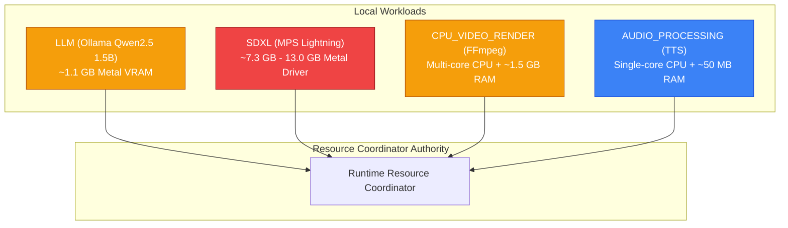
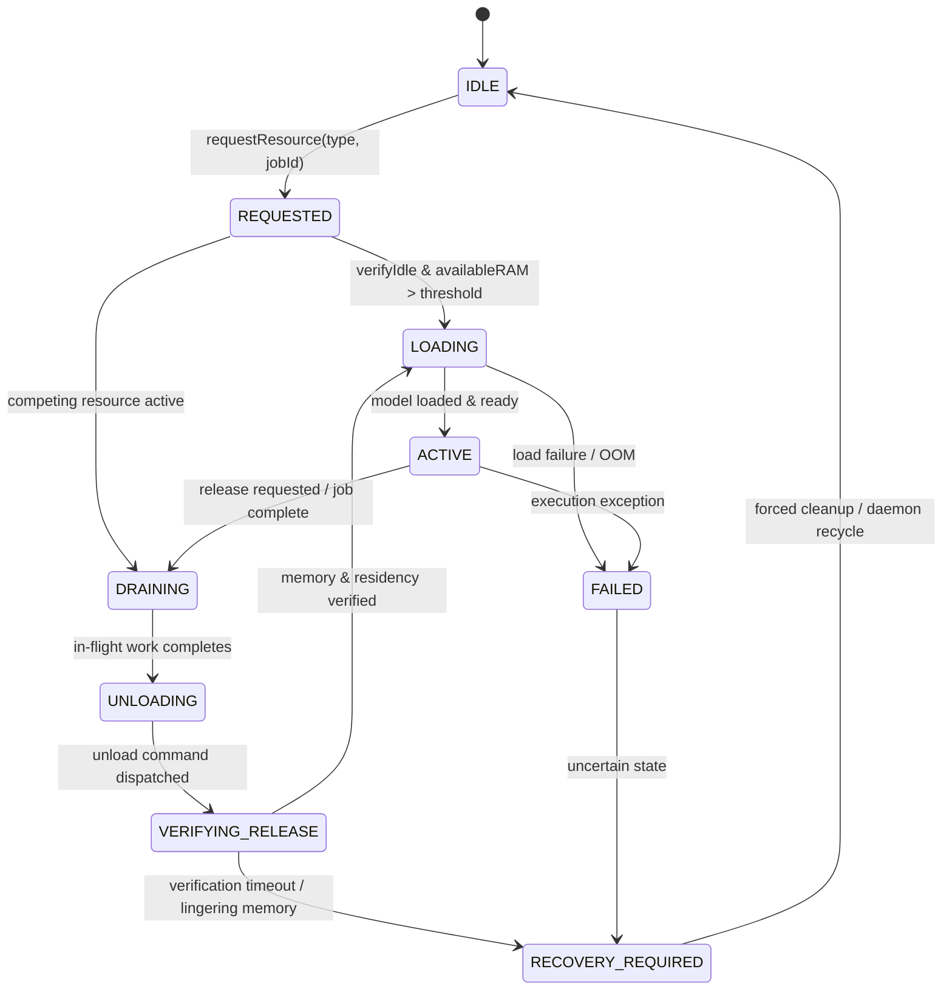
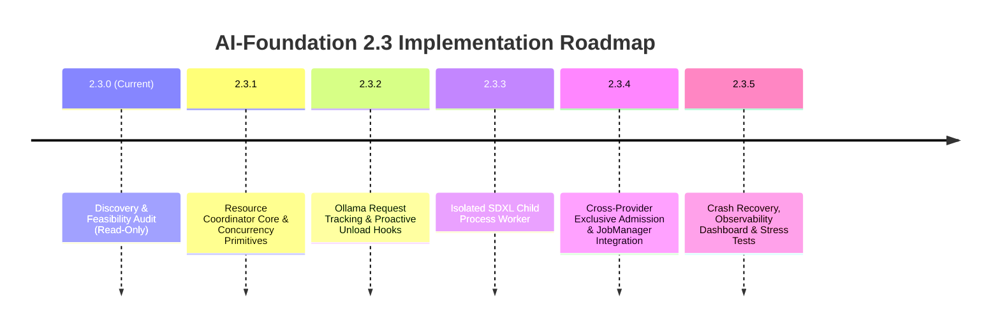

# Auravo Studio — AI-Foundation 2.3.0: Discovery & Feasibility Report
## Runtime Resource Coordination & Memory Lifecycle Discovery Audit

**Document ID:** `AURAVO-AIF2.3.0-RESOURCE-COORDINATION-20261116`  
**Phase:** AI-Foundation 2.3.0  
**Mode:** STRICT READ-ONLY ARCHITECTURAL AND HARDWARE FEASIBILITY AUDIT  
**Repository:** `/Users/abhisheksuman/Documents/GitHub/studio`  
**Branch:** `main`  
**Baseline Git Commit:** `b34e9ee6b10939de214dac8a3fb59ce13556d08b`  
**Audit Timestamp:** 2026-11-15T21:25:00+05:30  
**Monetary Budget:** $0.00 — strictly zero external cost  
**Executive Verdict:** `AI_FOUNDATION_2_3_0_READY_FOR_CONTROLLED_IMPLEMENTATION`

---

## 1. Executive Summary & Audit Mandate

Auravo Studio is engineered to operate high-fidelity local AI generation on consumer Apple Silicon hardware at strictly $0 monetary cost. The product encompasses two computationally intensive, memory-heavy workloads:

1. **Local LLM Inference:** Qwen2.5-1.5B-Instruct quantized at Q4_K_M via Ollama (`127.0.0.1:11434`), consuming ~986 MB model weights + ~117 MB KV cache in Metal unified memory.
2. **Local SDXL-Lightning Image Synthesis:** ByteDance 4-step distilled UNet with StabilityAI SDXL base 1.0, utilizing Apple Silicon MPS for float16 denoising and CPU FP32 VAE decoding, consuming between ~7.3 GB and ~13.0 GB in Metal driver allocations during active generation.

On the host machine (Apple M3 Pro with 18 GB unified memory), running both workloads concurrently or allowing an image generation job to commence while an LLM inference request is resident or computing introduces severe memory contention, aggressive page compression, swap thrashing (>4 GB swap observed in Phase 2B telemetry), and risk of macOS kernel Out-Of-Memory (OOM) termination.

This discovery audit provides a forensic evaluation of existing hardware, daemon lifecycles, application job queuing, and provider architectures. It establishes an evidence-based blueprint for a **Central Local Runtime Resource Coordinator** prior to application-level implementation.

---

## 2. Verified Hardware & Current Host Environment (Workstream A)

Physical hardware and operating system metrics were collected directly on the host using non-destructive system diagnostics (`sysctl`, `vm_stat`, `df`, `ps`):

| Hardware / OS Parameter | Verified Diagnostic Value | Forensic Notes |
| :--- | :--- | :--- |
| **Processor Model** | `Apple M3 Pro` | 11 cores (5 Performance, 6 Efficiency) |
| **Physical Unified Memory** | `19,327,352,832 bytes` (18.00 GB) | Shared dynamically between CPU and Metal GPU |
| **Virtual Page Size** | `16,384 bytes` (16 KiB) | Standard Apple Silicon page size |
| **Baseline Pages Free** | 29,756 pages (~487.5 MB) | Dynamically reclaimed by OS on demand |
| **Baseline Pages Active** | 407,495 pages (~6.68 GB) | Currently mapped and recently referenced |
| **Baseline Pages Inactive** | 393,155 pages (~6.44 GB) | Unmodified pages available for immediate reuse |
| **Baseline Pages Wired Down**| 142,952 pages (~2.34 GB) | Kernel, framework, and locked application memory |
| **Baseline Pages Purgeable** | 68,862 pages (~1.13 GB) | OS can purge instantaneously under memory pressure |
| **Compressor Occupied** | 149,470 pages (~2.45 GB) | Compressed RAM in memory compressor |
| **Calculated Available RAM** | **~8.06 GB to ~10.4 GB** | Free + Inactive + Speculative + Purgeable |
| **Current Swap Usage** | `total = 0.00M, used = 0.00M, free = 0.00M` | Clean baseline; zero active swap paging |
| **Available Disk Storage** | `128 GiB` on `/System/Volumes/Data` | Ample headroom for local model caching |
| **Active Heavy AI Processes**| 0 Python, 0 Torch, 0 SDXL processes | Host verified idle prior to audit |

### 2.1 Critical Distinction Between Memory Metrics
A critical architectural finding of this audit is that **Process RSS is completely insufficient** for evaluating Apple Silicon Metal AI workloads:
1. **Process RSS (Resident Set Size):** Measures only host CPU virtual memory pages mapped into the process's page table. In Phase 2B SDXL generation, Python process RSS was measured at only **145.09 MB**, while the Metal driver had allocated **13,002.77 MB (~13.0 GB)**!
2. **Metal Driver Allocated Memory (`mps_driver_mb`):** Measures Unified Memory buffers allocated directly by the Apple Metal driver for GPU execution (UNet tensors, KV cache, latent feature maps).
3. **Unified Memory Consumption:** Total system RAM committed across CPU and GPU frameworks.
4. **System Memory Pressure:** The macOS Mach kernel metric (Normal, Warning, Critical) indicating the frequency of memory compression and paging.
5. **Swap Usage:** Secondary NVMe storage utilized when physical unified memory is fully exhausted.

---

## 3. Ollama Lifecycle & Application Integration Inspection (Workstream B)

### 3.1 Daemon & Model State
- **Installed Version:** Ollama `0.18.2` (Homebrew standard build).
- **Service Process:** PID 708 (`/opt/homebrew/opt/ollama/bin/ollama`), managed via system launchd.
- **Process RSS:** `127,584 KB` (~124.6 MB) in idle state.
- **Network Binding:** Strictly loopback `http://127.0.0.1:11434`.
- **Installed Models in Storage:**
  - `qwen2.5:1.5b` (Q4_K_M, 986,061,892 bytes, GGUF format, parameter size 1.5B).
  - `moondream:latest` (Q4_0, 1,738,451,197 bytes, GGUF format, parameter size 1B).
- **Active Residency Query (`/api/ps`):** Returned `{"models":[]}`. Zero models are currently resident in Metal VRAM.

### 3.2 Provider Lifecycle Methods in Codebase
Inspecting `server/providers/llm.ts`:
- `OllamaLLMProvider` implements:
  - `ping()`: Queries `GET /api/version` (3s timeout).
  - `isModelLoaded()`: Queries `GET /api/ps` (5s timeout).
  - `unloadModel()`: Issues `POST /api/generate` with `{ model: this.model, keep_alive: 0 }` (10s timeout).
- **Architectural Gap in `FallbackLLMProvider`:**
  The default provider returned by `createDefaultLLMProvider()` is a `FallbackLLMProvider` that wraps `OllamaLLMProvider` and `LocalLLMProvider`. However, `FallbackLLMProvider` **only implements the `LLMProvider` interface** (`generateIdeas` and `generateStory`). It does **not** expose or delegate `unloadModel()`, `isModelLoaded()`, or `ping()`. Application callers holding the default provider instance cannot programmatically trigger model unloads!

### 3.3 Full LLM Request Lifecycle & Missing Controls
Traced execution path in `server/content_engine.ts` (`POST /ideas/generate` and `POST /ideas/:id/generate-script`):
1. **Request Accepted:** Express HTTP endpoint receives client request.
2. **Inline Execution:** Endpoint directly calls `await llm.generateStory(...)` or `await llm.generateIdeas(...)`.
3. **Ollama Request:** `OllamaLLMProvider` issues HTTP fetch to `127.0.0.1:11434/api/generate` with `AbortSignal.timeout(60000)`.
4. **Completion:** Upon receiving JSON, parses structured output, freezes metadata, and returns to caller.
5. **Model Left Resident:** Ollama's internal default keep-alive timer (5 minutes) begins. The model remains resident in Metal VRAM unless explicitly purged.

### 3.4 Request Tracking Deficiencies (Identified Gaps)
The application currently:
- **Does NOT track active in-flight LLM requests:** No global or provider-level request counter exists.
- **Does NOT track client timeouts:** When `AbortController` triggers at 60s, the client fetch terminates, but whether the Ollama daemon stops generation or continues computing until completion is **`NOT_PROVEN`**.
- **Does NOT guard concurrent requests:** Multiple simultaneous HTTP requests will issue concurrent inference requests to Ollama.
- **Does NOT coordinate with background jobs:** An asynchronous render job can start while an inline LLM request is generating.

---

## 4. SDXL Lifecycle & Pipeline Architecture Inspection (Workstream C)

### 4.1 Environment & Model Inventory
- **Dedicated Virtual Environment:** `/Users/abhisheksuman/.local/share/auravo/venvs/phase2a` (Python 3.11, PyTorch 2.1+, HuggingFace Diffusers 0.43.0, safetensors, psutil). Total disk size: **1.0 GB**.
- **Model Cache Directory:** `/Users/abhisheksuman/.local/share/auravo/models/phase2b/cache/` (Total disk size: **6.6 GB**):
  - UNet Weights: `ByteDance/SDXL-Lightning` 4-step distilled UNet (`sdxl_lightning_4step_unet.safetensors`, ~5.2 GB in blob cache).
  - Base Model: `stabilityai/stable-diffusion-xl-base-1.0` text encoders (CLIP ViT-L, OpenCLIP ViT-bigG), scheduler, and VAE (~1.5 GB).

### 4.2 Actual Execution Lifecycle in Phase 2B Experiment
Examining `/Users/abhisheksuman/.local/share/auravo/models/phase2b/experiment_runner.py`:
1. `NOT_LOADED`: System baseline established.
2. `LOADING`:
   - UNet instantiated on CPU in `float16`, weights loaded from safetensors.
   - `StableDiffusionXLPipeline` assembled with base 1.0 components.
   - Apple Silicon VAE NaN safeguard: `pipe.vae.to(dtype=torch.float32)` offloads VAE to CPU FP32.
   - Scheduler configured: `EulerDiscreteScheduler(timestep_spacing="trailing")`.
   - Pipeline moved to Metal: `pipe.to("mps")` followed by `torch.mps.synchronize()`.
   - **Load Latency:** ~16.5 seconds warm reload.
3. `READY`: Pipeline resident on MPS; `mps_driver_mb` sits at **7,256.45 MB (~7.3 GB)**.
4. `GENERATING`:
   - Denoising executed over 4 steps on MPS.
   - **Peak Memory During Generation:** `mps_driver_mb` peaked at **13,002.77 MB (~13.0 GB)**!
   - System available RAM collapsed to **2.48 GB**; swap usage spiked to **4,115.38 MB (4.1 GB)**.
5. `DECODING`: Latent representation decoded by VAE on CPU in FP32, eliminating black-image NaN corruption.
6. `CLEANUP`:
   - `del pipe; del unet; gc.collect()`
   - `torch.mps.empty_cache()`
   - `torch.mps.synchronize()`
   - `mps_allocated_mb` dropped to `0.0 MB`, but `mps_driver_mb` remained at **2,058.7 MB** (driver retention).
7. `RELEASED`: Full return of driver memory occurs only when the Python process terminates!

### 4.3 Production Integration Status
- **Status in Production Application:** **`NOT_IMPLEMENTED`** (Isolated Experiment Only).
- **Inspection of `server/providers/character_gen.ts` & `server/providers/image.ts`:**
  The production server currently synthesizes images via `AURAVO_LOCAL_HIGHRES_ENGINE` (Resvg SVG rasterization) or attempts an optional remote GPU worker URL (`NEURAL_DANCE_GPU_URL`). Local SDXL execution has **never been integrated** into the application server, `JobManager`, or API routers.

---

## 5. Existing Job & Provider Architecture Audit (Workstream D)

### 5.1 Analysis of `server/jobs.ts`
- **Job Creation:** `createJob()` inserts a row into SQLite `jobs` table with `status = 'QUEUED'`.
- **Job Execution Model:** `startRenderPipelineAsync()` is immediately triggered via `setImmediate(async () => { ... })`.
- **Absence of Concurrency Controls:**
  - **No Queue Worker:** There is no background polling loop or worker process.
  - **No Worker Pool or Cap:** If 5 render requests are submitted simultaneously, 5 concurrent FFmpeg / TTS render pipelines execute immediately on Node.js.
  - **No Hardware Reservation:** The job system has no knowledge of memory, GPU, or daemon status.
- **Cancellation Capabilities:**
  - `cancelJob()` marks SQLite status as `CANCELLED`.
  - The render pipeline polls its job status between scene beats. If `CANCELLED`, it aborts subsequent beats.
  - However, in-flight child processes (e.g., active FFmpeg encode or TTS synthesis) are **not killed**; they run to completion in the background.
- **Error Sanitization:** All internal paths and provider errors are mapped to five safe public categories (`GENERATION_FAILED`, `RENDER_FAILED`, `PROVIDER_UNAVAILABLE`, `INVALID_INPUT`, `INTERNAL_ERROR`), preserving local path security.

### 5.2 Decoupling of LLM Calls from Jobs
LLM story generation in `server/content_engine.ts` operates completely outside `JobManager`. It is executed as an inline HTTP request awaiting an asynchronous promise. Consequently:
- SQLite job serialization does **NOT** serialize inference or GPU resources.
- An inline LLM request and a background render job can execute concurrently without coordination.

---

## 6. Proposed Central Resource Coordinator Architecture (Workstream E)

To prevent simultaneous memory saturation on the 18 GB unified memory architecture, Auravo requires a unified, authoritative **Local Resource Coordinator**.

### 6.1 Resource Types & Mutual Exclusion Model



#### Workload Compatibility Matrix:

| Workload A | Workload B | Concurrency Allowed? | Rationale |
| :--- | :--- | :---: | :--- |
| **SDXL** | **SDXL** | **NO (EXCLUSIVE)** | Dual SDXL pipelines would require >20 GB, causing kernel panic or heavy swap. |
| **SDXL** | **LLM** | **NO (EXCLUSIVE)** | SDXL peak (13 GB) + LLM (1.1 GB) + OS base (6.5 GB) exceeds 18 GB RAM. |
| **SDXL** | **CPU_VIDEO_RENDER** | **NO (EXCLUSIVE)** | High CPU usage and memory spikes during video encoding degrade SDXL VAE decoding. |
| **SDXL** | **AUDIO_PROCESSING** | **NO (EXCLUSIVE)** | Strict isolation ensures SDXL has maximum unified memory headroom. |
| **LLM** | **LLM** | **YES (SHARED)** | Ollama naturally queues/batches requests internally; total VRAM remains ~1.1 GB. |
| **LLM** | **CPU_VIDEO_RENDER** | **YES (SHARED)** | Combined footprint (~1.1 GB Metal + ~1.5 GB CPU) operates safely under 10 GB. |
| **LLM** | **AUDIO_PROCESSING** | **YES (SHARED)** | Negligible resource overlap (~50 MB CPU vs 1.1 GB Metal). |

### 6.2 Coordinator State Machine



### 6.3 State Definitions & Transition Rules

1. `IDLE`: No exclusive resources reserved. System available RAM > 5.0 GB.
2. `REQUESTED`: Workload has requested resource lease. Coordinator checks current allocations.
3. `DRAINING`: Competing workload is informed to complete or abort active tasks. No new admissions granted.
4. `UNLOADING`: Coordinator dispatches unload command (`keep_alive: 0` for Ollama, SIGTERM to SDXL worker).
5. `VERIFYING_RELEASE`: Coordinator actively polls `/api/ps`, process status, and memory metrics to confirm deallocation.
6. `LOADING`: Target workload allocates models and initializes pipelines.
7. `ACTIVE`: Target workload executes generation.
8. `FAILED`: Workload threw an unhandled error or failed validation.
9. `RECOVERY_REQUIRED`: Fail-closed state entered when release cannot be proven, process hangs, or memory remains trapped.

### 6.4 The Twelve Mandatory Safety Rules

1. **No SDXL Load During Active LLM:** SDXL worker must never spawn while an LLM inference request is in-flight.
2. **No LLM Inference During SDXL Reservation:** Inbound LLM requests must be queued or routed to deterministic fallback when SDXL holds an exclusive lease.
3. **No Grant During Transition:** Resource grants are frozen while the coordinator is in `DRAINING`, `UNLOADING`, or `VERIFYING_RELEASE`.
4. **Client Timeout != Daemon Stop:** A client-side fetch abortion is classified as `NOT_PROVEN` regarding daemon inference cessation. An explicit `/api/ps` check and draining period must elapse.
5. **`keep_alive: 0` != Immediate Full RAM Recovery:** Verification requires checking `/api/ps` AND waiting for Metal driver release confirmation before launching SDXL.
6. **Fail-Closed on Unload Failure:** If unload verification fails or times out, the competing workload is rejected with `PROVIDER_UNAVAILABLE`.
7. **Fail-Closed on State Uncertainty:** Any corrupted state or unhandled exception transitions the coordinator to `RECOVERY_REQUIRED`.
8. **No Silent Force-Kill:** Active generation processes are given a graceful draining timeout (15s) before SIGTERM; SIGKILL is reserved for uncooperative recovery.
9. **Identifiable Lease Ownership:** Every lease must carry `resourceType`, `jobId`, `ownerId`, `acquiredAt`, and `expiresAt`.
10. **Single Exclusive Holder:** Concurrency primitives must prevent two jobs from acquiring `SDXL` concurrently.
11. **Crash Recovery for Stale Leases:** Leases have an automatic TTL (e.g., 180s). Stale leases are reaped on server restart or coordinator initialization.
12. **Observable Evidence Required:** A resource is never considered released without verifiable telemetry (`/api/ps` empty or process exited).

---

## 7. Memory Release & Verification Strategy (Workstream F)

To safely authorize the transition between LLM and SDXL workloads, the coordinator evaluates a 4-level verification hierarchy:

```
[Level 1: In-Flight Counter = 0]
       │ (Pass)
       ▼
[Level 2: Daemon Residency Query]  ──► Ollama: /api/ps == []
       │ (Pass)                         SDXL: Child process terminated
       ▼
[Level 3: Host OS Process State]   ──► Ollama RSS <= 150 MB; no child runner
       │ (Pass)                         Python worker PID absent from OS
       ▼
[Level 4: System Memory Headroom]  ──► Available RAM >= 5.0 GB (Hypothesis)
       │ (Pass)
       ▼
[RESOURCE AUTHORIZED FOR NEXT WORKLOAD]
```

### 7.1 Verification Criteria by Provider

| Workload | Deallocation Mechanism | Verifiable Evidence | Sufficient Release Proof |
| :--- | :--- | :--- | :--- |
| **Ollama LLM** | `POST /api/generate` with `keep_alive: 0` | 1. `GET /api/ps` returns `{"models":[]}`<br/>2. Ollama RSS <= 150 MB<br/>3. Zero in-flight requests in counter | `/api/ps` empty AND active request counter = 0 |
| **SDXL Image** | Child Process Termination (`SIGTERM` / clean exit) | 1. Python process exits with code 0<br/>2. Process PID no longer exists in OS<br/>3. Metal driver memory returns to base | Process termination (PID dead) |

### 7.2 Memory Pressure & Swap Admission Hypotheses
*Note: Numerical thresholds below are initial engineering hypotheses requiring empirical validation in Phase 2.3.1–2.3.5:*
- **Safe SDXL Admission Threshold:** System available memory must be **>= 5.0 GB** before launching SDXL pipeline.
- **Swap Behavior Rule:** macOS swap usage does not automatically reset to 0 upon deallocation. Existing swap is considered historical unless active swap churn (`Swapins` / `Swapouts` > 0 in `vm_stat`) is actively detected.

---

## 8. Failure & Recovery Matrix (Workstream G)

The matrix below evaluates all 15 operational failure scenarios:

| # | Scenario Description | Initial State | Final State | Next Job Allowed? | Retry Safe? | Recovery Action | Observable Evidence |
| :- | :--- | :--- | :--- | :---: | :---: | :--- | :--- |
| 1 | **Ollama normal success** | `ACTIVE` | `IDLE` | Yes | Yes | None; normal release. | Response received; counter decremented. |
| 2 | **Ollama client timeout** | `ACTIVE` | `DRAINING` | **NO** | No | Wait 15s draining; query `/api/ps`; issue `keep_alive: 0`. | Counter = 0; `/api/ps` returns `[]`. |
| 3 | **Ollama daemon unavailable** | `REQUESTED` | `FAILED` | Yes (Fallback) | Yes | Fall back to deterministic `LocalLLMProvider`. | HTTP connection refused (`ECONNREFUSED`). |
| 4 | **Ollama unload succeeds** | `UNLOADING` | `IDLE` | Yes | Yes | None; transition authorized. | `/api/ps` returns `[]`. |
| 5 | **Ollama unload requested, model remains resident** | `UNLOADING` | `RECOVERY_REQUIRED` | **NO** | No | Retry unload once; if persistent, block SDXL; flag alert. | `/api/ps` still contains model after 10s. |
| 6 | **Ollama active when SDXL job arrives** | `ACTIVE` | `DRAINING` | **NO (Queued)** | Yes | SDXL job queues in `REQUESTED`; wait for LLM to finish or drain. | LLM counter > 0; SDXL job status `QUEUED`. |
| 7 | **SDXL loading fails (e.g., file missing)** | `LOADING` | `FAILED` | Yes (LLM) | No | Release SDXL reservation; mark job `FAILED`. | Python process non-zero exit; error stderr. |
| 8 | **SDXL fails during MPS denoising** | `ACTIVE` | `FAILED` | Yes (after exit)| No | Terminate Python worker; release lease; mark job `FAILED`. | Child process error exit; PID gone. |
| 9 | **SDXL CPU VAE decoding fails** | `ACTIVE` | `FAILED` | Yes (after exit)| No | Terminate Python worker; release lease; mark job `FAILED`. | Child process error exit; PID gone. |
| 10| **SDXL cleanup fails in Python** | `ACTIVE` | `RECOVERY_REQUIRED` | **NO** | No | Force kill Python process (`SIGKILL`); verify PID exit. | Python process alive past timeout. |
| 11| **Python worker crashes (SIGSEGV/OOM)** | `ACTIVE` | `FAILED` | Yes (after poll)| No | Detect PID death via `child_process` exit event; reclaim lease. | Process exit code / signal received. |
| 12| **Node.js server restarts with active lease** | `UNKNOWN` | `IDLE` | Yes | Yes | Reclaim expired SQLite leases on startup; query `/api/ps`. | Database startup sweep; `/api/ps` check. |
| 13| **Two SDXL jobs arrive simultaneously** | `IDLE` | `ACTIVE` (Job 1)<br/>`QUEUED` (Job 2)| **NO** (Job 2 waits)| Yes | Job 1 granted lease; Job 2 queued in FIFO order. | Lease table has 1 active holder; Job 2 in queue. |
| 14| **LLM & SDXL arrive simultaneously** | `IDLE` | `ACTIVE` (LLM)<br/>`QUEUED` (SDXL)| **NO** (SDXL waits)| Yes | LLM prioritized for fast interactive completion (<1s); SDXL queues. | LLM counter = 1; SDXL lease `REQUESTED`. |
| 15| **Memory pressure rises unexpectedly** | `ACTIVE` | `DRAINING` | **NO** | No | SDXL aborts at step boundary; triggers early cleanup. | OS available RAM < 500 MB; memory alert. |

---

## 9. Architectural Options & Zero-Cost Feasibility Comparison (Workstream H)

Four potential coordinator architectures were compared under the strict $0 monetary cost constraint:

| Evaluation Criterion | Option 1: In-Process TS Coordinator | Option 2: SQLite-Backed Leases | Option 3: Dedicated Daemon Process | Option 4: Extended JobManager | **Recommended: Hybrid (1 + 2 + 4)** |
| :--- | :---: | :---: | :---: | :---: | :---: |
| **Monetary Cost** | **$0.00** | **$0.00** | **$0.00** | **$0.00** | **$0.00** |
| **External Dependencies** | None (Node.js standard) | None (Existing `better-sqlite3`) | IPC / Unix Socket tooling | None | **None** |
| **Crash Recovery** | Poor (Memory lost on crash) | Excellent (Persisted in DB) | Moderate | Good | **Excellent (DB lease + memory state)** |
| **Concurrency Safety** | Excellent (In-process mutex) | Moderate (SQLite locks) | Excellent | Moderate | **Maximum (Mutex + SQLite leases)** |
| **Interactive Latency** | Instant (<1ms) | Low (~2–5ms disk IO) | Moderate (IPC roundtrip) | Low | **Instant for LLM, Durable for SDXL** |
| **Implementation Complexity** | Low | Low-Moderate | High | Low | **Balanced & Clean** |
| **External Tooling Required** | No Redis/RabbitMQ | No Redis/RabbitMQ | Custom daemon script | No Redis/RabbitMQ | **Zero External Tooling** |

### 9.1 Recommended Architecture: Hybrid In-Process Mutex with SQLite Lease Persistence
- **In-Memory Concurrency Primitives (`ResourceCoordinator` in TypeScript):** Controls fast-path interactive LLM request counting, draining semaphores, and immediate in-process mutual exclusion without disk I/O overhead.
- **SQLite Lease Persistence (`resource_leases` table):** Records active hardware reservations (`resourceType`, `jobId`, `acquiredAt`, `heartbeatAt`). Enables instant, fail-safe recovery and stale-lease reclamation upon server restart.
- **Process Isolation for SDXL:** SDXL must execute as a **spawned child Python process worker** rather than an embedded C++ addon. When SDXL completes or fails, terminating the child process guarantees 100% reclamation of Python and Metal driver memory back to macOS.

---

## 10. Phased Implementation Roadmap (Workstream I)



### Phase Details

#### Phase 2.3.1: Resource Coordinator Core & Concurrency Primitives
- **Scope:** Create `server/resource_coordinator.ts` with explicit state machine (`IDLE`, `REQUESTED`, `ACTIVE`, `DRAINING`, `UNLOADING`, `VERIFYING_RELEASE`, `LOADING`, `FAILED`, `RECOVERY_REQUIRED`), in-memory mutex, and SQLite `resource_leases` persistence.
- **Files to Change:** `server/resource_coordinator.ts` (new), `server/db.ts` (add `resource_leases` schema).
- **Required Tests:** Unit tests for concurrent lease acquisition, FIFO queue ordering, timeout rejection, and state transition validity.

#### Phase 2.3.2: Ollama Request Tracking & Proactive Unload Hooks
- **Scope:** Enhance `FallbackLLMProvider` and `OllamaLLMProvider` to expose lifecycle methods (`unloadModel`, `isModelLoaded`). Add active in-flight request tracking in `server/content_engine.ts` with coordinated draining hooks.
- **Files to Change:** `server/providers/llm.ts`, `server/providers/types.ts`, `server/content_engine.ts`.
- **Required Tests:** Concurrent request counter validation, draining on lease request, client timeout handling without hanging.

#### Phase 2.3.3: Isolated SDXL Child Process Worker
- **Scope:** Implement `server/workers/sdxl_worker.py` and a TypeScript wrapper `server/providers/local_sdxl.ts`. Executes SDXL generation as an isolated child process via `child_process.spawn`. Monitors memory and guarantees process exit on completion.
- **Files to Change:** `server/providers/local_sdxl.ts` (new), `server/workers/sdxl_worker.py` (new), `server/providers/character_gen.ts`.
- **Required Tests:** Worker spawn, progress streaming, output verification, error exit handling, and complete process memory reclamation.

#### Phase 2.3.4: Cross-Provider Exclusive Admission & JobManager Integration
- **Scope:** Connect `JobManager` in `server/jobs.ts` to `ResourceCoordinator`. Enforce exclusive reservation before SDXL character generation or master rendering begins. Route LLM requests to deterministic fallback during active SDXL reservations.
- **Files to Change:** `server/jobs.ts`, `server/content_engine.ts`.
- **Required Tests:** End-to-end contention tests: SDXL job queued while LLM active; LLM routed to fallback while SDXL active; zero concurrent GPU collisions.

#### Phase 2.3.5: Crash Recovery, Observability Dashboard & Stress Tests
- **Scope:** Implement startup stale-lease reclamation. Expose `/api/system/resources` telemetry endpoint for UI monitoring. Execute automated stress tests simulating process crashes, rapid cancellations, and low memory conditions.
- **Files to Change:** `server/resource_coordinator.ts`, `server/app.ts`, `server/test/resource_coordinator.test.ts` (new).
- **Required Tests:** Server restart with active lease, SIGKILL recovery, 100-request rapid concurrency test, 0 memory leaks.

---

## 11. Zero-Cost & Licensing Compliance

| Component / Workload | Classification | Cost | Licensing Verification |
| :--- | :--- | :---: | :--- |
| **Hardware Diagnostic Tooling** | `FREE_OPEN_SOURCE_LOCAL` | $0.00 | Built-in macOS system binaries (`sysctl`, `vm_stat`, `df`, `ps`) |
| **Ollama Local Inference Daemon** | `FREE_OPEN_SOURCE_LOCAL` | $0.00 | MIT License |
| **Qwen2.5-1.5B-Instruct Model** | `FREE_OPEN_SOURCE_LOCAL` | $0.00 | Apache 2.0 License |
| **SDXL-Lightning Model Weights** | `FREE_OPEN_SOURCE_LOCAL` | $0.00 | ByteDance SDXL-Lightning License (Permissive commercial/research use) |
| **StabilityAI SDXL Base 1.0** | `FREE_OPEN_SOURCE_LOCAL` | $0.00 | CreativeML Open RAIL++-M License |
| **HuggingFace Diffusers & PyTorch** | `FREE_OPEN_SOURCE_LOCAL` | $0.00 | Apache 2.0 / Modified BSD |
| **SQLite Database Engine** | `FREE_OPEN_SOURCE_LOCAL` | $0.00 | Public Domain |
| **Proposed Resource Coordinator** | `FREE_OPEN_SOURCE_LOCAL` | $0.00 | Proprietary Auravo internal TypeScript/SQLite architecture |

**Compliance Verdict:** 100% compliant with the mandatory $0 monetary cost constraint. Zero paid APIs, cloud services, subscriptions, or external orchestrators.

---

## 12. Exact Files Inspected During Audit

1. `/Users/abhisheksuman/Documents/GitHub/studio/package.json`
2. `/Users/abhisheksuman/Documents/GitHub/studio/server/app.ts`
3. `/Users/abhisheksuman/Documents/GitHub/studio/server/jobs.ts`
4. `/Users/abhisheksuman/Documents/GitHub/studio/server/content_engine.ts`
5. `/Users/abhisheksuman/Documents/GitHub/studio/server/experiments.ts`
6. `/Users/abhisheksuman/Documents/GitHub/studio/server/providers/llm.ts`
7. `/Users/abhisheksuman/Documents/GitHub/studio/server/providers/types.ts`
8. `/Users/abhisheksuman/Documents/GitHub/studio/server/providers/image.ts`
9. `/Users/abhisheksuman/Documents/GitHub/studio/server/providers/character_gen.ts`
10. `/Users/abhisheksuman/Documents/GitHub/studio/server/providers/video.ts`
11. `/Users/abhisheksuman/Documents/GitHub/studio/server/providers/quality_gate.ts`
12. `/Users/abhisheksuman/.local/share/auravo/models/phase2b/experiment_runner.py`
13. `/Users/abhisheksuman/.local/share/auravo/models/phase2b/telemetry.json`
14. `/Users/abhisheksuman/Documents/GitHub/studio/docs/business-audit/AI_FOUNDATION_2_1_LLM_BENCHMARK_REPORT.md`
15. `/Users/abhisheksuman/Documents/GitHub/studio/docs/business-audit/AI_FOUNDATION_2_2_2_2_REMEDIATION_REPORT.md`

---

## 13. Initial & Final Git State

- **Initial Git HEAD:** `b34e9ee6b10939de214dac8a3fb59ce13556d08b`
- **Final Git HEAD:** `b34e9ee6b10939de214dac8a3fb59ce13556d08b`
- **Initial Working Tree:** 15 modified files, 53 untracked files (pre-existing work preserved untouched).
- **Final Working Tree:** Exactly identical, plus the new discovery report `docs/business-audit/AI_FOUNDATION_2_3_0_RESOURCE_COORDINATION_DISCOVERY_REPORT.md`.
- **Modifications to Code/Tests:** **0 lines modified**, strictly read-only execution.

---

## 14. Unverified Assumptions & Known Limitations

1. **Ollama Daemon Cancellation Behavior (`NOT_PROVEN`):**
   When an HTTP fetch request is aborted with `signal: AbortSignal.timeout()`, the client ceases waiting. Whether the underlying Ollama daemon immediately cancels GPU computation or continues generating tokens in the background is unproven. The coordinator must assume inference continues until proven idle via `/api/ps` or draining timeout.
2. **Delayed Metal Driver Reclamation:**
   Even when `torch.mps.empty_cache()` succeeds, the macOS Metal driver may retain unified memory allocations until process termination. Executing SDXL in an isolated child process that terminates upon completion is necessary to guarantee prompt memory return.
3. **Dynamic Memory Pressure Variability:**
   Available memory is subject to background macOS processes (Safari, WindowServer, Xcode). Numerical admission thresholds (e.g. >= 5.0 GB available) must be empirically validated across varying host workloads during Phase 2.3.1.

---

## 15. Final Executive Verdict & Recommendation

```
================================================================================
FINAL AUDIT VERDICT: AI_FOUNDATION_2_3_0_READY_FOR_CONTROLLED_IMPLEMENTATION
================================================================================
1. Hardware Feasibility: Confirmed Apple M3 Pro with 18 GB unified memory
   can operate both Ollama LLM and SDXL workloads, PROVIDED they are strictly
   serialized via exclusive mutual exclusion.
2. Architecture Feasibility: Confirmed a zero-dependency, zero-cost Hybrid
   In-Process Mutex with SQLite Lease Persistence can be cleanly integrated
   into Auravo Studio without external queuing infrastructure.
3. Strict Read-Only Audit Complete: Zero lines of application code modified,
   zero models downloaded, zero inference run.
4. Recommendation: Proceed to AI-Foundation 2.3.1 (Resource Coordinator Core)
   upon user review and explicit authorization.
================================================================================
```

