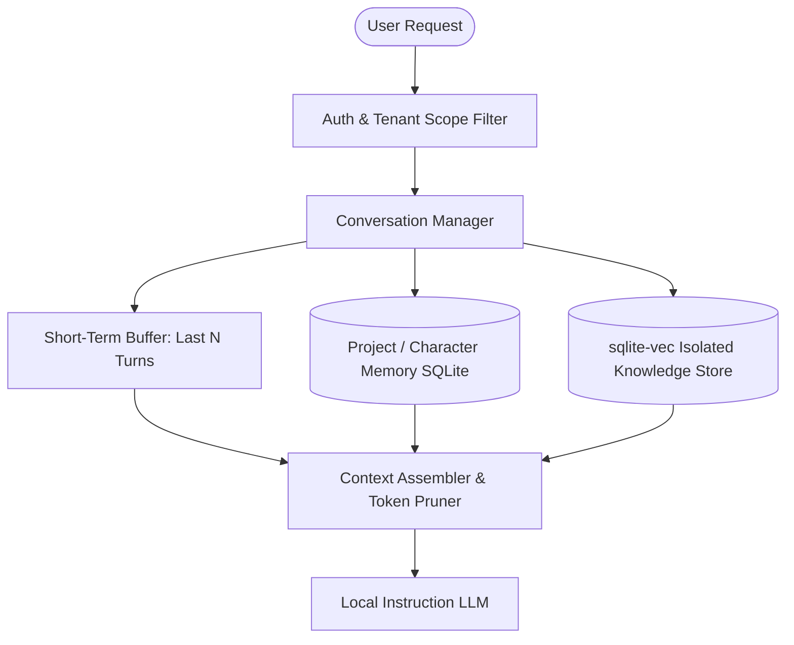

# Auravo Studio — Phase 2C.0.5: AI Core Architecture Discovery & Capability Audit Report

**Document ID:** `AURAVO-P2C0.5-AI-CORE-AUDIT-20261115`  
**Date:** November 15, 2026  
**Mode:** READ-ONLY ARCHITECTURAL AND IMPLEMENTATION AUDIT  
**Repository:** `/Users/abhisheksuman/Documents/GitHub/studio`  
**Branch:** `main`  
**Baseline Commit:** `b34e9ee6b10939de214dac8a3fb59ce13556d08b`  
**Auditor:** Principal AI Systems Architect, LLM Infrastructure Engineer & Senior Application Architect  
**Final Audit Verdict:** **`AI_CORE_AUDIT_READY_WITH_CONDITIONS`**

---

## 1. Executive Summary & Audit Verdict

A comprehensive, read-only architectural and implementation audit was conducted across Auravo Studio to evaluate the repository's readiness for transformation into a unified, reusable AI platform supporting:
1. A general-purpose conversational assistant.
2. Character Studio (identity, attributes, style).
3. Motion Studio (choreography, beats, pose guidance).
4. Video Studio (story planning, shot composition, audio sync, master rendering).
5. Shared AI Core infrastructure (LLM, RAG, memory, prompt engineering, agent orchestration).

### 1.1 Final Audit Verdict
# **`AI_CORE_AUDIT_READY_WITH_CONDITIONS`**

### 1.2 Verdict Rationale & Architectural Reality Summary
1. **The LLM Implementation is Completely Simulated:**  
   The existing `LocalLLMProvider` in [server/providers/llm.ts](file:///Users/abhisheksuman/Documents/GitHub/studio/server/providers/llm.ts) contains **zero neural network inference, zero local model weights, zero tokenizers, and zero external LLM API calls**. It is a deterministic, procedural TypeScript generator using 6 hardcoded string templates, trigonometric scoring (`Math.sin`/`Math.cos`), and string interpolation. While it satisfies unit tests by returning shaped JSON objects, Auravo currently has **no functional conversational or generative LLM capability**.
2. **The RAG Engine is In-Memory Substring Token Matching:**  
   The `RAGEngine` in [server/providers/rag_engine.ts](file:///Users/abhisheksuman/Documents/GitHub/studio/server/providers/rag_engine.ts) does not implement vector embeddings, chunking, or semantic search. It executes an un-indexed JavaScript loop matching query words against pre-seeded tags and titles in memory.
3. **Critical Security & Privacy Flaw in RAG Store:**  
   The underlying database table [server/migrations/006_rag_knowledge.sql](file:///Users/abhisheksuman/Documents/GitHub/studio/server/migrations/006_rag_knowledge.sql) **omits `ownerId` entirely**. Any authenticated user can list, search, or insert knowledge records via `POST /api/rag/knowledge`. Ingested items are immediately visible to all other users and injected into their story prompts, introducing a severe **cross-tenant data leakage and prompt-injection/poisoning vulnerability**.
4. **Hardware Feasibility Confirmed for Small Local Models:**  
   The host Apple M3 Pro (18 GB Unified Memory) with Apple Metal Performance Shaders (MPS) can comfortably host a quantized 3B–7B parameter instruction LLM (e.g., Qwen2.5-3B-Instruct or Llama-3.2-3B-Instruct at Q4_K_M requiring ~2.2 GB RAM) alongside a lightweight local embedding model (`bge-small-en-v1.5` requiring ~133 MB RAM) and `sqlite-vec`. However, **simultaneous execution of SDXL diffusion (6.6 GB resident) and a 7B LLM (4.8 GB resident) will cause severe memory pressure and swap thrashing**. A sequential model loading/unloading orchestration layer is mandatory.
5. **Zero-Monetary-Cost Compliance:**  
   Zero paid APIs, zero subscriptions, and zero hosted infrastructure are required. A complete, production-grade local AI stack can be constructed using open-source, commercially permissive (Apache 2.0 / MIT) local components.

---

## 2. Repository Baseline & Working-Tree Status

### 2.1 Git Environment
- **Branch:** `main`
- **HEAD Commit:** `b34e9ee6b10939de214dac8a3fb59ce13556d08b`
- **Audit Mode:** Strictly Read-Only. No application files, database tables, dependencies, or Git state were modified during this investigation.

### 2.2 Working-Tree Status (`git status --short`)
```text
 M docs/business-audit/00_EXECUTIVE_SUMMARY.md
 M docs/business-audit/01_existing_product_audit.md
 M docs/business-audit/06_technical_commercial_readiness.md
 M package.json
 M server/app.ts
 M server/content_engine.ts
 M server/jobs.ts
 M server/providers/quality_gate.ts
 M server/providers/types.ts
 M server/providers/video.ts
 M web/main.tsx
?? docs/business-audit/PHASE_2C_0_4_SECURITY_REMEDIATION_REPORT.md
?? docs/business-audit/phase-1a-alignment/
?? docs/business-audit/phase1c_1_independent_verification_report.md
... [Historical Phase reports preserved]
?? server/experiments.ts
?? server/test/audio_configuration.test.ts
?? server/test/experiments_api.test.ts
?? server/test/ffmpeg_composition.test.ts
?? web/experiments_views.tsx
```
*Note: All tracked modifications and untracked files are preserved from completed Phases 1C, 2C.0, 2C.0.2, and 2C.0.4.*

---

## 3. Workstream A — Existing LLM Implementation Audit

A line-by-line inspection of the repository for LLM providers, local inference runtimes (Ollama, llama.cpp, Transformers, Hugging Face, PyTorch, ONNX), and chat completion wrappers was conducted across `server/`, `ai_worker/`, `web/`, `scripts/`, and `server/test/`.

### 3.1 LLM Implementation Breakdown

| Field | Audit Finding / Technical Reality |
|---|---|
| **Provider Class** | `LocalLLMProvider` implementing interface `LLMProvider` |
| **Source Location** | [server/providers/llm.ts](file:///Users/abhisheksuman/Documents/GitHub/studio/server/providers/llm.ts#L4-L177); Interface in [server/providers/types.ts](file:///Users/abhisheksuman/Documents/GitHub/studio/server/providers/types.ts#L71-L74) |
| **Model Identifier** | None. No model name, weights file, or checkpoint exists or is referenced. |
| **Runtime Environment** | Pure Node.js JavaScript runtime. No Python bridge, no child process invocation, no WASM, no native binding. |
| **Inference Reality** | **SIMULATED / PROCEDURAL HARDCODED GENERATOR**. Zero neural weights are evaluated. |
| **Input Format** | Takes strongly typed domain objects (`BrandContext`, `CharacterContext`, `topic`, `customPremise`). Does not accept arbitrary conversational messages (`Role: 'user' | 'assistant'`). |
| **Output Format** | Returns structured objects (`IdeaItem[]` or `GeneratedStory` containing 5 `GeneratedStoryScene` objects). |
| **Persistence** | Ideas and scripts are persisted in SQLite tables `content_ideas` and `scripts` via CRUD routes in `server/content_engine.ts`. No raw prompt/completion history is logged. |
| **Streaming Support** | **ABSENT**. Methods return non-streamed `Promise<T>`. |
| **Existing Test Coverage** | [server/test/rag_engine.test.ts](file:///Users/abhisheksuman/Documents/GitHub/studio/server/test/rag_engine.test.ts#L66-L105) (`Local LLM Provider with RAG - Authentic Mudras & Viral Hooks in 5-Scene Story`). |
| **What Tests Genuinely Verify** | The test asserts that `story.scenes.length === 5` and that strings like `"alapadma"` or `"chakkar"` from RAG search appear inside the concatenated prompt strings. It verifies TypeScript object assembly, **not language model intelligence**. |
| **Limitations & Gaps** | No conversational chat; no tool calling; no arbitrary reasoning; no token budgeting; rigid 5-scene structure hardcoded in source. |

### 3.2 Detailed Source Inspection of `LocalLLMProvider`
In [server/providers/llm.ts](file:///Users/abhisheksuman/Documents/GitHub/studio/server/providers/llm.ts#L11-L80):
- `generateIdeas`: Iterates through an array of 6 fixed template objects (`"The Hidden Tempo"`, `"Shadow & Spotlight"`, `"The Velvet Mask"`, `"Overture at Midnight"`, `"Echoes in the Wings"`, `"The Grand Finale Illusion"`). Scores are generated via deterministic math formulas:
  ```typescript
  const potentialScore = 80 + Math.floor(Math.sin(i + 1) * 12 + 5);
  const originalityScore = 85 + Math.floor(Math.cos(i + 2) * 10 + 4);
  const visualPotentialScore = 88 + Math.floor(Math.sin(i * 3) * 8 + 3);
  ```
- `generateStory`: Constructs exactly 5 scenes using string interpolation templates:
  - Scene 1: Overhead golden spotlight, hook narration.
  - Scene 2: Close-up gaze and hands executing mudras (`retrievedMudraText`).
  - Scene 3: Full-body dance choreography (`retrievedChoreoMovement`).
  - Scene 4: High-angle freeze frame climax pose.
  - Scene 5: Outro card and rewatch hook.

### 3.3 Inspection of `ai_worker/` and Remote Scripts
- `ai_worker/main.py`: Contains Stable Video Diffusion (`stabilityai/stable-video-diffusion-img2vid-xt`) and LivePortrait face animation wrappers. **Contains zero LLM endpoints**.
- `scripts/colab_dance_diffusion_server.py`: Identical to `ai_worker/main.py`. **Contains zero LLM endpoints**.
- `package.json`: Contains `@gradio/client`, `@resvg/resvg-js`, `better-sqlite3`, `express`, `react`, `zod`. **Zero LLM libraries installed** (no `ollama`, `openai`, `langchain`, `transformers.js`, etc.).

---

## 4. Workstream B — Existing RAG Architecture Audit

An audit of the Retrieval-Augmented Generation implementation was performed across [server/providers/rag_engine.ts](file:///Users/abhisheksuman/Documents/GitHub/studio/server/providers/rag_engine.ts), [server/migrations/006_rag_knowledge.sql](file:///Users/abhisheksuman/Documents/GitHub/studio/server/migrations/006_rag_knowledge.sql), and the endpoints in [server/content_engine.ts](file:///Users/abhisheksuman/Documents/GitHub/studio/server/content_engine.ts#L227-L260).

### 4.1 RAG Capability Assessment Matrix

| # | RAG Capability | Current Status | Audit Finding & Code Evidence |
|---|---|---|---|
| 1 | **Knowledge Ingestion** | `PARTIALLY_IMPLEMENTED` | `seedDefaultsIfNeeded()` inserts 12 hardcoded records at startup; `POST /api/rag/knowledge` accepts manual JSON. |
| 2 | **Document Parsing** | `NOT_IMPLEMENTED` | Zero parsers for PDF, Markdown, DOCX, HTML, or plain text files. |
| 3 | **Text Extraction** | `NOT_IMPLEMENTED` | No text extraction pipelines exist. |
| 4 | **Chunking & Splitting** | `NOT_IMPLEMENTED` | Raw strings stored whole. No recursive character, token, or semantic chunking. |
| 5 | **Metadata Assignment** | `IMPLEMENTED_AND_VERIFIED` | Category (`CHOREOGRAPHY`, `VIRAL_HOOKS`, `CHARACTER_CONSISTENCY`, `SAFETY_POLICY`), tags array, and JSON `metadata` stored. |
| 6 | **Embedding Generation** | `NOT_IMPLEMENTED` | **Zero vector embeddings generated**. No embedding models or API wrappers exist in repo. |
| 7 | **Vector Storage** | `NOT_IMPLEMENTED` | No vector index, no `sqlite-vss`, no `sqlite-vec`, no Chroma, no FAISS. Stored as plain text in SQLite table `rag_knowledge`. |
| 8 | **Keyword Search** | `IMPLEMENTED_AND_VERIFIED` | In-memory tokenization and substring matching (`tags.includes(token) * 3 + title.includes(token) * 2 + content.includes(token) * 1`). |
| 9 | **Semantic Similarity Search** | `NOT_IMPLEMENTED` | What the code comments label "semantic search" is actually literal token substring matching. |
| 10 | **Hybrid Retrieval** | `NOT_IMPLEMENTED` | No fusion of dense and sparse retrieval algorithms. |
| 11 | **Re-ranking** | `NOT_IMPLEMENTED` | Pure integer score sorting in memory. |
| 12 | **Context Assembly** | `IMPLEMENTED_AND_VERIFIED` | `enrichPromptWithRAG` constructs `[AUTHENTIC CHOREOGRAPHY & CONSISTENCY KNOWLEDGE BASE]: • [CAT] Title: Content` and appends instruction. |
| 13 | **Source Attribution** | `IMPLEMENTED_AND_VERIFIED` | `enrichPromptWithRAG` returns `{ enrichedPrompt, citations: string[] }`. |
| 14 | **Retrieval Permissions / Tenant Isolation** | `NOT_IMPLEMENTED` (CRITICAL) | **Table `rag_knowledge` has NO `ownerId`**. Search queries all rows globally. |
| 15 | **Knowledge Updates & Deletion** | `NOT_IMPLEMENTED` | API supports only `GET` and `POST`. No `PUT`, `PATCH`, or `DELETE` endpoints exist. Items cannot be updated or deleted. |
| 16 | **Integration with LLM Provider** | `IMPLEMENTED_AND_VERIFIED` | Injected into `LocalLLMProvider` constructor; extracts top mudra and hook strings for story assembly. |

### 4.2 Security & Tenant Isolation Analysis of RAG API
In [server/content_engine.ts](file:///Users/abhisheksuman/Documents/GitHub/studio/server/content_engine.ts#L228-L260):
```typescript
// GET /api/rag/knowledge - Lists ALL items globally across all tenants
router.get('/rag/knowledge', (req: Request, res: Response) => {
  const category = req.query.category as string | undefined;
  const items = ragEngine.listKnowledge(category); // No userId filtering!
  res.json(items);
});

// GET /api/rag/search - Searches ALL items globally across all tenants
router.get('/rag/search', (req: Request, res: Response) => {
  const q = (req.query.q as string) || '';
  const results = ragEngine.search(q, { category, limit }); // No userId filtering!
  res.json(results);
});

// POST /api/rag/knowledge - Inserts GLOBAL knowledge visible to every user
router.post('/rag/knowledge', (req: Request, res: Response) => {
  // Accepts category, title, content, tags, metadata...
  // BUT does not record ownerId!
  const created = ragEngine.addKnowledge(p.data);
  res.status(201).json({ ok: true, item: created });
});
```
**Critical Defect Identified:**
Because `ownerId` is absent from `rag_knowledge`, User A can write malicious or proprietary data into the knowledge base, which is immediately retrieved by User B's search queries and injected into User B's generation prompts.

---

## 5. Workstream C — Prompt Engineering Infrastructure Audit

Prompt construction patterns were audited across Character Generation, Content Engine, Image Provider, Quality Gate, and Experiments.

### 5.1 Audit Questions & Observations

| Capability | Audit Question | Existing Reality in Auravo Codebase |
|---|---|---|
| **System Prompts** | Is there a central system instruction layer? | **NO**. System instructions are hardcoded ad-hoc strings embedded inside provider methods. |
| **Templates** | Are prompts reusable? | **PARTIALLY**. Hardcoded string templates exist in `server/providers/llm.ts` and `server/providers/character_gen.ts`, but are not decoupled into templates. |
| **Versioning** | Can prompt changes be tracked? | **NO**. Prompts are static TypeScript code; prompt changes require code edits and redeployments. |
| **Variables** | Are dynamic values safely injected? | **PARTIALLY**. Values are injected via JavaScript template literals (`` `portrait of ${name}, ${appearance}` ``). No escaping of LLM control tokens. |
| **Context Assembly** | Is retrieved context separated from user input? | **YES**. `enrichPromptWithRAG` wraps retrieved items in `[AUTHENTIC CHOREOGRAPHY & CONSISTENCY KNOWLEDGE BASE]: ...` blocks. |
| **Model Adaptation** | Are prompts adapted to different model templates? | **NO**. Prompts do not format for ChatML, Llama-3 `<|header|>`, or Qwen template formats. |
| **Structured Output** | Is JSON/schema output validated? | **N/A**. Current provider returns static TypeScript objects directly. When real LLMs are integrated, schema enforcement (e.g. Zod + JSON mode) will be required. |
| **Token Budgeting** | Are model context limits respected? | **NO in LLM; YES in SDXL CLIP**. SDXL CLIP token budgeting was audited in Phase 2B.4A (condensing prompt to 63 tokens to fit 77-token CLIP limit). In LLM, no token counting exists. |
| **Prompt Evaluation** | Can outputs be benchmarked? | **NO**. Zero prompt benchmark suites or evaluation metrics exist. |
| **Prompt Security** | Are prompt injection and untrusted documents handled? | **NO**. If user input or RAG documents contain `"Ignore previous instructions"`, the prompt builder blindly concatenates it into the instruction block. |

### 5.2 Duplication & Consolidation Opportunities
1. **Character Visual Prompts:** Generated in `server/providers/character_gen.ts:136`, duplicated in `server/providers/image.ts:36-45`, and again in `server/content_engine.ts:1043-1056`.
2. **Negative Prompts:** Hardcoded identically (`'blurry, distorted, bad anatomy, deformed eyes, extra limbs, low resolution, cartoonish...'`) in three separate files.
3. **Recommendation:** Establish a central `PromptRegistry` with versioned templates, parameter schema validation, token length bounds, and sanitization filters.

---

## 6. Workstream D — Conversation Memory and Context Audit

### 6.1 Current Memory State
- **Conversation Session Schema:** **NONEXISTENT**. There is no `conversations`, `chat_sessions`, or `messages` table in the database schema.
- **Message History:** **NONEXISTENT**. User requests are single-shot HTTP transactions.
- **Context Summarization:** **NONEXISTENT**.
- **Long-Conversation Handling:** **NONEXISTENT**.
- **Retrieval of Previous Conversations:** **NONEXISTENT**.

### 6.2 Existing Context Anchors
While true conversational memory is absent, Auravo possesses several persistent domain context anchors in SQLite:
1. `audience_profiles`: Target demographic, interests, tone, and topics to avoid.
2. `brands`: Brand identity, visual style, content rules, allowed/prohibited topics.
3. `characters`: Locked persona appearance, identity tokens, costume, personality, voice style.
4. `assets`: Generated and uploaded images, videos, audio tracks, and reference slices.

### 6.3 Recommended Privacy-Aware Memory Architecture
To support the future general-purpose assistant and multi-turn Studio refinements without privacy leaks:

- **Tenant Scoping:** Every conversation session and memory entry must include `ownerId` and `brandId` with foreign-key cascading deletes.
- **Tiered Memory:**
  1. *Turn Memory:* In-memory sliding window (last 6–10 turns) formatted to model context budget.
  2. *Summary Memory:* Background LLM summarization of older dialogue turns stored in a `conversation_summaries` table.
  3. *Entity Memory:* Explicit user preferences and character traits extracted and stored in structured key-value tables.
- **Privacy & Deletion:** Immediate cascading delete of all message history upon user request via `DELETE /api/conversations/:id`.

---

## 7. Workstream E — Tool Calling and Agent Orchestration Audit

### 7.1 Existing Architecture Classification
Auravo's existing execution model is a **Deterministic Sequential Workflow Engine**, **NOT an autonomous reasoning agent**.

- **Workflow State Machine:** Implemented in [server/jobs.ts](file:///Users/abhisheksuman/Documents/GitHub/studio/server/jobs.ts#L14-L25) (`QUEUED` $\to$ `INITIALIZING` $\to$ `GENERATING_CHARACTER` $\to$ `ANIMATING_FACE` $\to$ `GENERATING_MOTION` $\to$ `SYNTHESIZING_VOICE` $\to$ `RENDERING_MASTER` $\to$ `QUALITY_CHECK` $\to$ `COMPLETED`).
- **Human-in-the-Loop Approval:** Implemented in [server/content_engine.ts](file:///Users/abhisheksuman/Documents/GitHub/studio/server/content_engine.ts) (`READY_FOR_REVIEW` $\to$ `APPROVED_FOR_PUBLISH` via `/content/:id/approve`). Requires `QualityGateEngine.evaluate()` before status transition.
- **Tool Calling Capabilities:**
  - Function calling schema: **ABSENT**.
  - Tool execution by LLM: **ABSENT**.
  - Autonomous multi-step planning: **ABSENT**.
  - LLM cannot invoke shell, database, filesystem, or HTTP actions.

### 7.2 Proposed Secure Agent Orchestration Architecture
When upgrading to an autonomous assistant that can execute studio operations (e.g. *"Regenerate scene 2 with crimson lighting and export the video"*):
1. **Decoupled Planning:** The LLM proposes actions by generating strictly validated JSON matching a Zod schema (`tool_name`, `arguments`).
2. **Deterministic Security Gate:** The Node.js application layer inspects the proposed tool call, verifies tenant ownership (`ownerId = uid(req)`), checks resource quotas, and evaluates safety rules.
3. **Execution Sandbox:** The application executes the operation (e.g., queues a job in `jobs` table) and returns the execution result to the LLM context.
4. **Absolute Boundary:** The LLM is **never granted direct access** to execute shell commands, SQL queries, or file system modifications.

---

## 8. Workstream F — Multimodal AI Architecture Audit

### 8.1 Current Multimodal Implementation State

Auravo's multimodal components currently operate as siloed, independent implementations rather than a unified pipeline:

| Capability | Current Technical Reality | Standard Category Classification | Notes / Gaps |
|---|---|---|---|
| **Character Image Generation** | Remote Kaggle GPU endpoint if configured; local fallback is Resvg SVG rasterization. Local SDXL Base + Lightning 4-step verified in Phase 2B.4B offline. | `STATIC_IMAGE` | High-photorealism 1024x1024 portraits verified on Apple MPS; not yet wired into Express runtime. |
| **Character Identity Consistency** | Native img2img evaluated in Phase 2B.5.3 (face preserved, wardrobe locked); masked inpainting audited in Phase 2B.5.4. Prompt token anchoring used in runtime. | `STATIC_IMAGE` | True identity-preserving decoupled generation remains an active experimental area. |
| **Motion Generation** | Audio tempo detection, 5-beat slicing, YouTube reference video download (disabled fail-closed in 2C.0.4). | `PROCEDURAL_ANIMATION` | Beat detection and duration matching are fully automated via FFmpeg. |
| **Face Animation** | Remote LivePortrait GPU endpoint if configured; local fallback is FFmpeg eye-line anchored `zoompan`. | `CAMERA_MOTION_ONLY` | Local execution is 2D camera translation, not neural facial mesh deformation. |
| **Full-Body Dance Animation** | Remote SVD XT endpoint if configured; local fallback is Ken Burns camera translation. | `CAMERA_MOTION_ONLY` | Neural body movement diffusion is blocked locally on Apple M3 Pro due to compute limits. |
| **Audio Voice Narration** | macOS CLI `say` with FFmpeg MP3 encoding; fallback to pink noise. | `PROCEDURAL_ANIMATION` | Functional on macOS; zero cloud cost; robotic quality. |
| **Audio Soundtrack Mixing** | FFmpeg `amix` with beat detection and volume ducking. | `PROCEDURAL_ANIMATION` | Fully verified, zero monetary cost. |
| **Video Master Composition** | FFmpeg multi-stream concat, subtitle burn-in, YUV420p 1080x1920 export. | `PROCEDURAL_ANIMATION` | Fully verified production-grade composite video assembly. |

---

## 9. Workstream G — Local Hardware and Model Feasibility Audit

### 9.1 Host Hardware Baseline
- **Hardware:** Apple M3 Pro
- **Unified Memory:** 18 GB Unified Memory (shared dynamically between CPU, GPU, and Neural Engine)
- **CPU:** 11-core Apple Silicon (5 Performance + 6 Efficiency cores)
- **GPU:** 14-core Metal GPU with Apple Metal Performance Shaders (MPS)
- **Operating System:** macOS Darwin 25.0.0 (`arm64`)
- **Python Environment:** `/Users/abhisheksuman/.local/share/auravo/venvs/phase2a` (Python 3.13.14, PyTorch 2.15.0 MPS, Diffusers 0.43.0, Transformers 5.23.0)

### 9.2 Unified Memory Budget Analysis (18 GB RAM)

Running modern generative AI models locally requires rigorous memory budgeting:

```text
[Total Available Unified Memory: 18,432 MB (18.0 GB)]
  ├── macOS System Base & Studio Server:  ~3,500 MB (Reserved)
  └── Available for AI Workloads:         ~14,500 MB
```

#### Scenario 1: Text LLM + RAG Assistant Mode
- Quantized 7B LLM (e.g., Qwen2.5-7B at Q4_K_M): ~4,800 MB
- Embedding Model (`bge-small-en-v1.5`): ~150 MB
- Context Window KV-Cache (8k tokens): ~800 MB
- Total Peak RAM: **~5,750 MB** $\to$ **FEASIBLE with 8.7 GB headroom.**

#### Scenario 2: SDXL Character Generation Mode (Phase 2B.1 Baseline)
- SDXL Base 1.0 + Lightning 4-step UNet (MPS FP16): ~6,600 MB
- CPU VAE Decoder (CPU FP32): ~1,500 MB
- Total Peak RAM: **~8,100 MB** $\to$ **FEASIBLE with 6.4 GB headroom.**

#### Scenario 3: Simultaneous LLM + SDXL Execution (DANGEROUS)
- System Base: 3,500 MB
- SDXL Pipeline: 8,100 MB
- 7B LLM + KV-Cache: 5,600 MB
- Total Peak RAM: **17,200 MB (93.3% of physical RAM)** $\to$ **CRITICAL SWAP THRASHING RISK**.
- Operating system will invoke compressed memory and disk paging, causing severe execution latency spikes and potential kernel OOM kills.

#### Scenario 4: Lightweight 3B LLM + SDXL (Balanced Option)
- System Base: 3,500 MB
- SDXL Pipeline: 8,100 MB
- Quantized 3B LLM (e.g. Qwen2.5-3B at Q4_K_M): ~2,200 MB
- Embedding Model: ~150 MB
- Total Peak RAM: **~13,950 MB (75.7% of physical RAM)** $\to$ **STABLE with 4.5 GB safety buffer.**

### 9.3 Candidate Local Models Specification Matrix

All candidate models below comply with the strict **$0 monetary-cost requirement** and are runnable locally on Apple Silicon:

| Model Identifier | Parameter Count | Quantization Format | Resident Memory | Context Window | License & Commercial Terms | Zero-Cost Classification | Recommendation / Role |
|---|---|---|---|---|---|---|---|
| **Qwen/Qwen2.5-3B-Instruct** | 3.09B | GGUF (Q4_K_M) | **~2.2 GB** | 32k tokens | Apache 2.0 (Permissive, unrestricted commercial use) | `FREE_OPEN_SOURCE_LOCAL` | **HIGHLY RECOMMENDED** for dual-mode execution (Assistant + Studios) |
| **Qwen/Qwen2.5-7B-Instruct** | 7.61B | GGUF (Q4_K_M) | **~4.8 GB** | 32k tokens | Apache 2.0 (Permissive, unrestricted commercial use) | `FREE_OPEN_SOURCE_LOCAL` | **RECOMMENDED** for dedicated high-reasoning assistant mode (unload SDXL) |
| **meta-llama/Llama-3.2-3B-Instruct** | 3.21B | GGUF (Q4_K_M) | **~2.4 GB** | 128k tokens | Llama 3.2 Community License (Commercial permitted for <700M MAU) | `FREE_OPEN_SOURCE_LOCAL` | Suitable alternative to Qwen-3B |
| **HuggingFaceTB/SmolLM2-1.7B-Instruct** | 1.71B | GGUF (Q4_K_M) | **~1.2 GB** | 8k tokens | Apache 2.0 (Permissive, unrestricted commercial use) | `FREE_OPEN_SOURCE_LOCAL` | Ultra-lightweight fallback for background task automation |
| **BAAI/bge-small-en-v1.5** | 33.5M | ONNX / PyTorch | **~133 MB** | 512 tokens | MIT License (Permissive, unrestricted commercial use) | `FREE_OPEN_SOURCE_LOCAL` | **HIGHLY RECOMMENDED** for local dense semantic embeddings |
| **sentence-transformers/all-MiniLM-L6-v2** | 22.7M | ONNX / PyTorch | **~90 MB** | 256 tokens | Apache 2.0 (Permissive, unrestricted commercial use) | `FREE_OPEN_SOURCE_LOCAL` | Compact alternative embedding model |
| **ByteDance/SDXL-Lightning** | 2.6B | FP16 Safetensors | **~5.1 GB** | 77 tokens | CreativeML Open RAIL++-M (Commercial permitted with ethical terms) | `FREE_OPEN_SOURCE_LOCAL` | Verified Character Studio image generation backbone |
| **stabilityai/stable-diffusion-xl-base-1.0** | 3.5B | FP16 Safetensors | **~6.6 GB** | 77 tokens | CreativeML Open RAIL++-M (Commercial permitted with ethical terms) | `FREE_OPEN_SOURCE_LOCAL` | Verified base diffusion checkpoint |

---

## 10. Workstream H — Proposed Architecture for Unified Auravo AI Core

To transition from the current hardcoded procedural mockups to a unified, scalable AI platform, the following three-tier architecture is proposed:

```
┌────────────────────────────────────────────────────────────────────────────────────────┐
│                                   AURAVO STUDIO UI                                     │
│     [ Conversational Assistant ]  [ Character Studio ]  [ Motion Studio ]  [ Video ]   │
└───────────────────────────────────────────┬────────────────────────────────────────────┘
                                            │ Typed API Requests / WebSockets
┌───────────────────────────────────────────▼────────────────────────────────────────────┐
│                             AURAVO SHARED AI CORE ENGINE                               │
│                                                                                        │
│  ┌─────────────────────────┐  ┌─────────────────────────┐  ┌────────────────────────┐  │
│  │   Conversation Engine   │  │   Prompt & Template Hub │  │   Tool Registry & Gate │  │
│  │ • Session state manager │  │ • Versioned templates   │  │ • Zod action schemas   │  │
│  │ • Sliding turn buffer   │  │ • Control token hygiene │  │ • Permission checker   │  │
│  │ • Multi-tenant isolation│  │ • Model adapter formats │  │ • Job queue dispatcher │  │
│  └────────────┬────────────┘  └────────────┬────────────┘  └───────────┬────────────┘  │
│               │                            │                           │               │
│  ┌────────────▼────────────────────────────▼───────────────────────────▼────────────┐  │
│  │                           Orchestrator & Agent Runtime                           │  │
│  │ • Structured JSON generation & validation  • Multi-step execution coordinator     │  │
│  └─────────────────────────────────────────┬────────────────────────────────────────┘  │
│                                            │                                           │
│  ┌─────────────────────────────────────────▼────────────────────────────────────────┐  │
│  │                                 RAG 2.0 Subsystem                                │  │
│  │ • Local dense embeddings (`bge-small`)     • `sqlite-vec` vector storage         │  │
│  │ • Multi-tenant `ownerId` filtering         • Hybrid keyword + dense search       │  │
│  └─────────────────────────────────────────┬────────────────────────────────────────┘  │
│                                            │                                           │
│  ┌─────────────────────────────────────────▼────────────────────────────────────────┐  │
│  │                       Local Model Inference & Memory Manager                     │  │
│  │ • llama.cpp / node-llama-cpp / Ollama bridge • Sequential load/unload scheduler │  │
│  │ • Unified memory monitor (18 GB boundary)   • MPS acceleration coordinator       │  │
│  └──────────────────────────────────────────────────────────────────────────────────┘  │
└───────────────────────────────────────────┬────────────────────────────────────────────┘
                                            │ Local Storage / OS
┌───────────────────────────────────────────▼────────────────────────────────────────────┐
│                    PERSISTENT STORAGE & HARDWARE ACCELERATION                          │
│     [ SQLite (studio.db + sqlite-vec) ]    [ Apple Silicon Metal (MPS / M3 Pro) ]      │
└────────────────────────────────────────────────────────────────────────────────────────┘
```

### 10.1 Module Mapping: Existing Code vs. Required New Components

| AI Core Component | Existing Code Base | Required New Module / Evolution |
|---|---|---|
| **LLM Provider Abstraction** | [server/providers/llm.ts](file:///Users/abhisheksuman/Documents/GitHub/studio/server/providers/llm.ts) | Create `server/core/llm/` with a unified `LlmInterface` supporting `chat()`, `generate()`, and `stream()`. |
| **Local Inference Runtime** | Absent | Add local engine wrapper using `node-llama-cpp` or a local Ollama daemon for GGUF execution. |
| **Model Registry & Scheduler** | Absent | Implement `ModelScheduler` enforcing sequential loading to prevent 18 GB memory exhaustion. |
| **Prompt Template Hub** | Ad-hoc templates in source | Create `server/core/prompts/` with versioned templates, variable validation, and token limiters. |
| **Vector RAG Subsystem** | [server/providers/rag_engine.ts](file:///Users/abhisheksuman/Documents/GitHub/studio/server/providers/rag_engine.ts) | Evolve into `RAG 2.0` with `sqlite-vec` and `bge-small-en-v1.5` embeddings, adding `ownerId` scoping. |
| **Conversation Memory** | Absent | Add `conversations` and `messages` SQLite tables with tenant scoping and cascading delete. |
| **Tool Registry & Security** | Ad-hoc routes in `content_engine.ts` | Create `ToolRegistry` exposing typed Studio functions to the LLM via Zod schema definitions. |
| **Agent Orchestration** | Rigid state machine in `server/jobs.ts` | Connect LLM structured output to `JobManager` for multi-step autonomous workflows. |

---

## 11. Workstream I — Security, Privacy, and Governance Audit

### 11.1 Security Vulnerabilities & Threat Model

| Threat / Risk Vector | Severity | Existing Status in Repository | Required Remediation |
|---|---|---|---|
| **Cross-Tenant RAG Leakage** | **CRITICAL** | `rag_knowledge` table has no `ownerId`. All knowledge is globally accessible. | Add `ownerId INTEGER REFERENCES users(id)` migration; scope all queries with `WHERE ownerId = ? OR isSystemDefault = 1`. |
| **RAG Prompt Poisoning** | **HIGH** | `POST /api/rag/knowledge` allows any user to inject strings that get concatenated into other users' prompts. | Restrict public knowledge writes; validate inputs; isolate custom knowledge to tenant. |
| **Direct Prompt Injection** | **HIGH** | User strings in brand tone and topic are concatenated without control-token stripping into instruction templates. | Sanitize prompt inputs; use clear system/user delimiters; employ ChatML or Llama-3 special token formatting. |
| **Arbitrary LLM Action Execution** | **MEDIUM** | Currently safe because LLM has zero execution capability. | When adding tools, LLM must **never** receive direct shell, eval, or raw SQL access. Only structured, pre-validated actions. |
| **Model Supply Chain & License** | **LOW** | SDXL Base & Lightning verified as CreativeML Open RAIL++-M. LAION-2B IP-Adapter placed on legal hold in Phase 2B.5.2. | Maintain zero-cost, vetted model registry. Vette any new LLM or embedding model against commercial restrictions. |

---

## 12. Comprehensive Capability Matrix

The current implementation state of all AI capabilities across Auravo Studio is summarized below:

| Capability | Status | Source Location | Test Verification | Missing Requirements | Next Recommended Action |
|---|---|---|---|---|---|
| **Conversational Chat** | `NOT_IMPLEMENTED` | N/A | None | Real LLM runtime, message store, chat UI | Integrate GGUF runtime (AI-Foundation 2) |
| **Script / Idea Generation** | `TEST_ONLY_OR_MOCKED` | [server/providers/llm.ts](file:///Users/abhisheksuman/Documents/GitHub/studio/server/providers/llm.ts#L11) | `rag_engine.test.ts` (verifies string return) | Genuine generative reasoning; dynamic creativity | Connect LocalLLMProvider to GGUF engine |
| **Knowledge Base Storage** | `IMPLEMENTED_NOT_VERIFIED` | [server/migrations/006_rag_knowledge.sql](file:///Users/abhisheksuman/Documents/GitHub/studio/server/migrations/006_rag_knowledge.sql) | Table created, but security unverified | `ownerId` tenant isolation column | Migrate table schema to add `ownerId` |
| **Keyword RAG Search** | `IMPLEMENTED_AND_VERIFIED` | [server/providers/rag_engine.ts](file:///Users/abhisheksuman/Documents/GitHub/studio/server/providers/rag_engine.ts#L153) | `rag_engine.test.ts` (passes) | True semantic similarity; document ingestion | Upgrade to `sqlite-vec` + dense embeddings |
| **Vector Semantic Search** | `NOT_IMPLEMENTED` | N/A | None | Embeddings model, vector extension | Deploy `bge-small-en-v1.5` with `sqlite-vec` |
| **Prompt Template Management** | `PARTIALLY_IMPLEMENTED` | Dispersed in providers | None | Central registry, versioning, schema checks | Build `PromptRegistry` hub |
| **Conversational Memory** | `NOT_IMPLEMENTED` | N/A | None | Session schema, message history tables | Create `conversations` SQLite migration |
| **Tool Calling / Function Exec**| `NOT_IMPLEMENTED` | N/A | None | Action schemas, permission gate | Build Zod tool registry |
| **Background Workflow Engine** | `IMPLEMENTED_AND_VERIFIED` | [server/jobs.ts](file:///Users/abhisheksuman/Documents/GitHub/studio/server/jobs.ts) | `async_jobs.test.ts` (passes) | LLM planner integration | Connect LLM actions to `JobManager` |
| **Character Portrait Diffusion** | `IMPLEMENTED_NOT_VERIFIED` | `server/providers/character_gen.ts` | Verified in offline audit (2B.4B); not wired to live app | Real-time pipeline dispatch inside app server | Wire offline MPS diffusion into background job |
| **Character Identity Locking** | `PARTIALLY_IMPLEMENTED` | [server/providers/character_gen.ts](file:///Users/abhisheksuman/Documents/GitHub/studio/server/providers/character_gen.ts#L44) | Token extraction verified in test | Decoupled identity-preserving inpainting | Audit masked inpainting in live server |
| **Face Animation (Local)** | `IMPLEMENTED_AND_VERIFIED` | [server/providers/face_animator.ts](file:///Users/abhisheksuman/Documents/GitHub/studio/server/providers/face_animator.ts#L141) | `face_animation.test.ts` (passes) | True neural facial mesh deformation | Clarify as `CAMERA_MOTION_ONLY` in UI |
| **Full-Body Dance Video (Local)**| `BLOCKED_BY_ZERO_COST_CONSTRAINT` | [server/providers/neural_dance.ts](file:///Users/abhisheksuman/Documents/GitHub/studio/server/providers/neural_dance.ts) | Remote GPU worker only; local fallback | Local neural video diffusion exceeds M3 Pro RAM | Maintain camera motion fallback locally |
| **Audio Beat Detection** | `IMPLEMENTED_AND_VERIFIED` | [server/providers/video.ts](file:///Users/abhisheksuman/Documents/GitHub/studio/server/providers/video.ts) | `ffmpeg_composition.test.ts` (passes) | None (FFmpeg beat detection fully functional) | Ready for production use |
| **Voice Narration (TTS)** | `IMPLEMENTED_AND_VERIFIED` | `server/providers/tts.ts` | `phase2_content_engine.test.ts` (passes) | High-fidelity neural voice (macOS `say` is robotic) | Evaluate local zero-cost Piper TTS |
| **Composite Video Export (MP4)**| `IMPLEMENTED_AND_VERIFIED` | [server/providers/video.ts](file:///Users/abhisheksuman/Documents/GitHub/studio/server/providers/video.ts) | `ffmpeg_composition.test.ts` (passes) | None (FFmpeg export fully functional) | Ready for production use |

---

## 13. Prioritized Development Roadmap (AI-Foundation 1–8)

The following staged roadmap outlines the path to a fully unified, zero-cost AI platform:

### AI-Foundation 1 — Existing Implementation Stabilization
- **Goal:** Remediate critical security flaws in the existing RAG knowledge store.
- **Tasks:** Add database migration for `ownerId` in `rag_knowledge`; enforce tenant scoping across all CRUD routes; implement `PUT` and `DELETE` endpoints; add automated security regression tests.
- **Effort:** 1–2 Engineering Days.
- **Cost / Dependencies:** $0.00. Existing SQLite infrastructure.

### AI-Foundation 2 — Local LLM Runtime Integration
- **Goal:** Replace simulated `LocalLLMProvider` with a real, local quantized LLM engine on Apple Silicon.
- **Tasks:** Integrate `node-llama-cpp` or a local Ollama daemon; evaluate Qwen2.5-3B-Instruct (Q4_K_M, ~2.2 GB RAM); measure inference latency (target: >20 tokens/sec on M3 Pro); implement sequential model unload safeguards.
- **Effort:** 3–4 Engineering Days.
- **Cost / Dependencies:** $0.00. Apache 2.0 open-source software and model weights.

### AI-Foundation 3 — Centralized Prompt Engineering Framework
- **Goal:** Consolidate distributed prompt strings into a versioned, secure template hub.
- **Tasks:** Create `PromptRegistry`; implement parameter validation with Zod; add special-token escaping to neutralize prompt injection; enforce CLIP (77-token) and LLM context window limits.
- **Effort:** 2–3 Engineering Days.
- **Cost / Dependencies:** $0.00. Existing TypeScript environment.

### AI-Foundation 4 — RAG 2.0 & Vector Retrieval Enhancement
- **Goal:** Upgrade keyword token matching to true semantic retrieval.
- **Tasks:** Integrate `sqlite-vec` C extension into `better-sqlite3`; load local `bge-small-en-v1.5` (ONNX / ~133 MB); implement document chunking and dense vector indexing with strict tenant scoping.
- **Effort:** 4–5 Engineering Days.
- **Cost / Dependencies:** $0.00. MIT/Apache 2.0 local packages.

### AI-Foundation 5 — Conversation History & Tiered Context Memory
- **Goal:** Enable persistent, multi-turn conversational interaction for Studio refinements.
- **Tasks:** Create `conversations` and `messages` tables; implement sliding-window turn buffer; add privacy controls and full cascading delete endpoints.
- **Effort:** 3–4 Engineering Days.
- **Cost / Dependencies:** $0.00. Existing SQLite database.

### AI-Foundation 6 — Tool Calling & Secure Agent Orchestration
- **Goal:** Allow the LLM to safely trigger Studio operations through structured actions.
- **Tasks:** Define typed Studio tools (`generate_character`, `slice_beats`, `render_video`); build LLM tool-calling prompt format; enforce application-level authentication and permission checks before execution.
- **Effort:** 4–5 Engineering Days.
- **Cost / Dependencies:** $0.00. Existing Express & Zod infrastructure.

### AI-Foundation 7 — Multimodal AI Core Integration
- **Goal:** Connect Text, Image, Audio, and Video model providers through unified interfaces.
- **Tasks:** Wire offline SDXL Base + Lightning pipeline into application background worker; implement unified status and telemetry reporting across all modalities.
- **Effort:** 5–6 Engineering Days.
- **Cost / Dependencies:** $0.00. Existing Phase 2B model cache and FFmpeg engine.

### AI-Foundation 8 — General-Purpose Conversational Assistant
- **Goal:** Deploy the full conversational assistant in the Auravo Studio UI.
- **Tasks:** Add conversational chat interface in React frontend; connect assistant to shared AI Core (RAG, Memory, Tools); support document Q&A, workflow automation, and multimodal generation.
- **Effort:** 5–7 Engineering Days.
- **Cost / Dependencies:** $0.00. Existing React 18 / Vite 5 setup.

---

## 14. Zero-Cost & Dependency Licensing Assessment

Every proposed model, package, and component is categorized in accordance with the mandatory cost and licensing framework:

| Component | Proposed Version / Checkpoint | License | Category Classification | Commercial Clearance Status |
|---|---|---|---|---|
| **Qwen2.5-3B-Instruct** | Qwen/Qwen2.5-3B-Instruct (GGUF) | Apache 2.0 | `FREE_OPEN_SOURCE_LOCAL` | Cleared for unrestricted commercial use ($0.00) |
| **Qwen2.5-7B-Instruct** | Qwen/Qwen2.5-7B-Instruct (GGUF) | Apache 2.0 | `FREE_OPEN_SOURCE_LOCAL` | Cleared for unrestricted commercial use ($0.00) |
| **Llama-3.2-3B-Instruct** | meta-llama/Llama-3.2-3B-Instruct | Llama 3.2 Community | `FREE_OPEN_SOURCE_LOCAL` | Cleared for commercial use under 700M MAU ($0.00) |
| **bge-small-en-v1.5** | BAAI/bge-small-en-v1.5 | MIT | `FREE_OPEN_SOURCE_LOCAL` | Cleared for unrestricted commercial use ($0.00) |
| **all-MiniLM-L6-v2** | sentence-transformers/all-MiniLM-L6-v2 | Apache 2.0 | `FREE_OPEN_SOURCE_LOCAL` | Cleared for unrestricted commercial use ($0.00) |
| **sqlite-vec** | sqlite-vec (asg017/sqlite-vec) | Apache 2.0 / MIT | `FREE_OPEN_SOURCE_LOCAL` | Cleared for unrestricted commercial use ($0.00) |
| **node-llama-cpp** | node-llama-cpp (with Metal acceleration) | MIT | `FREE_OPEN_SOURCE_LOCAL` | Cleared for unrestricted commercial use ($0.00) |
| **SDXL Base 1.0** | stabilityai/stable-diffusion-xl-base-1.0 | CreativeML Open RAIL++-M | `FREE_OPEN_SOURCE_LOCAL` | Permitted for commercial SaaS hosting ($0.00) |
| **SDXL-Lightning** | ByteDance/SDXL-Lightning | CreativeML Open RAIL++-M | `FREE_OPEN_SOURCE_LOCAL` | Permitted for commercial SaaS hosting ($0.00) |
| **LivePortrait** | Kelingte/LivePortrait | Non-Commercial / Research | `LICENCE_RESTRICTED` | **BLOCKED for commercial deployment**; remote only |
| **OpenCLIP ViT-H/14** | laion/CLIP-ViT-H-14-laion2B-s32B-b79K | LAION-2B Pretraining Data | `LICENCE_RESTRICTED` | **ON LEGAL HOLD** (Phase 2B.5.2 finding) |

---

## 15. Explicit Limitations & Unresolved Questions

1. **Local Neural Dance Diffusion is Blocked on 18 GB RAM:**  
   Generating full-body, high-frame-rate neural dance videos locally via video diffusion models (SVD, AnimateDiff) requires compute and VRAM that exceed the local Apple M3 Pro hardware. Procedural Ken Burns camera motion over high-resolution static portraits remains the only viable zero-cost local video animation method.
2. **Sequential Model Loading Latency:**  
   Because SDXL Base and a 7B LLM cannot be kept in 18 GB memory simultaneously without risk of swap thrashing, switching between conversational planning and image generation requires loading and unloading model weights from SSD storage (~3–6 seconds overhead per switch). Adopting a smaller 3B model (e.g. Qwen2.5-3B, ~2.2 GB) reduces this friction significantly.
3. **TTS Voice Quality vs. Zero Cost:**  
   macOS `say` is reliable, fast, and 100% free, but produces synthetic, robotic narration. A future phase should benchmark open-source, local neural TTS engines (e.g. Piper TTS, MIT License) on Apple Silicon to achieve broadcast-grade narration without cloud subscriptions.

---

## 16. Audit Conclusion & Exit Gate

The Phase 2C.0.5 audit establishes that while Auravo Studio has a functional procedural video assembly engine and robust test foundation, its AI intelligence layer is currently simulated. Transforming Auravo into a genuine AI platform is **100% technically feasible on existing Apple Silicon hardware at $0 monetary cost**, subject to the security remediations and memory-orchestration constraints identified herein.

**Status:** Completed and locked. Awaiting user review before any implementation is authorized.

