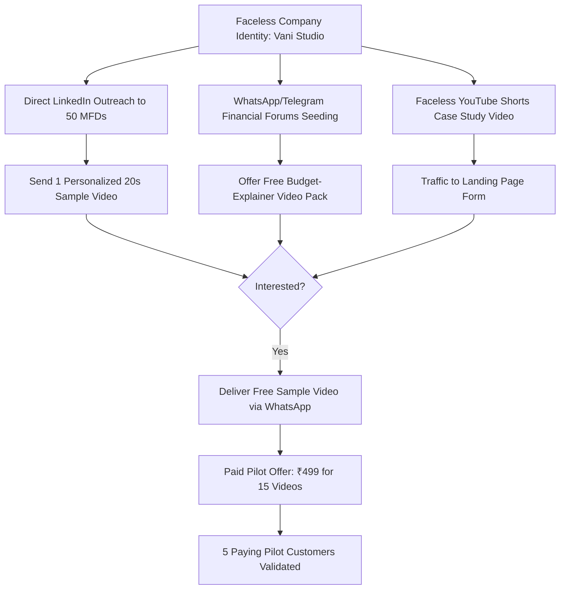

# 06. The Zero-to-Five Customer Validation Experiment

**Stage**: Phase 0.1 — Independent Commercial Validation & Pivot Approval Gate  
**Experiment Design**: Concierge & Wizard-of-Oz Commercial Smoke Test  
**Objective**: Validate genuine willingness to pay among Indian financial distributors and regional educators **BEFORE writing any SaaS backend code or integrating payment gateways**.  
**Founder Constraints Enforced**: 100% online, faceless company brand, zero door-to-door sales, zero paid ad spend.  

---

## 1. The Core Scientific Premise

Before writing multi-tenant registration code, Razorpay billing webhooks, or job queues, we must answer one question:  
**Will 5 real Indian professionals pay money (even ₹499–₹799) for this specific output?**

Instead of building a multi-tenant web SaaS first, the founder acts as the automated engine behind the scenes (Wizard-of-Oz):
1. Prospect enters their topic and firm details into a simple Google Form / Typeform on a landing page.
2. The founder uses the existing local FFmpeg engine and scripts on their local machine to render the video in 2 minutes.
3. The video is delivered to the prospect via WhatsApp/Email.
4. When the prospect asks for more, they are presented with a live payment link (Razorpay Payment Page or UPI QR) for a paid beta pack.

---

## 2. The 3 Customer Personas for the Experiment

```
┌────────────────────────────────────────────────────────────────────────────────────────┐
│ Persona 1: Rajesh Sharma (Mutual Fund Distributor - MFD)                               │
│ • Location: Pune / Lucknow                                                             │
│ • Practice: Manages ₹12 Crore retail AUM; 150 active family clients.                   │
│ • Urgent Pain: Knows younger clients are on Instagram Reels; terrified of being on     │
│   camera; static posters from AMCs get 2 likes.                                        │
│ • Trigger Pitch: "30 Ready-to-Post Hindi Financial Literacy Reels with your ARN & Logo"│
├────────────────────────────────────────────────────────────────────────────────────────┤
│ Persona 2: Subhashis Ghosh (Regional Educational Creator / WBPSC Tutor)                │
│ • Location: Kolkata / Siliguri                                                         │
│ • Practice: Runs a regional YouTube channel teaching general studies for state exams.  │
│ • Urgent Pain: Spends 4 hours every evening recording and editing short video notes.   │
│ • Trigger Pitch: "Turn daily current affairs notes into authentic Bengali reels in 30s"│
├────────────────────────────────────────────────────────────────────────────────────────┤
│ Persona 3: Amit Verma (Independent Health & Term Insurance Advisor)                    │
│ • Location: Jaipur / Indore                                                            │
│ • Practice: Independent broker selling Star Health and HDFC Life policies.             │
│ • Urgent Pain: Desperately needs warm leads; tired of cold calling phone databases.   │
│ • Trigger Pitch: "Explain health inflation and claim settlement facts in simple Hindi" │
└────────────────────────────────────────────────────────────────────────────────────────┘
```

---

## 3. The 3 Demonstration Assets to Pre-Produce

Before reaching out to a single customer, produce 3 pristine 45-second vertical 1080x1920 demonstration videos using the existing FFmpeg engine:

1. **Demo Video 1 (Hindi - Investment Literacy)**:
   - Topic: *"SIP vs Fixed Deposit in 2026: The ₹50 Lakh Compounding Secret"*.
   - Visual: Clean comparison cards showing returns over 15 years.
   - Voice: Native Hindi neural narration (*"Kya aap jaante hain ki har mahine sirf ₹3,000 invest karke..."*).
   - Branding: Demo MFD firm name + AMFI compliance banner at bottom.
2. **Demo Video 2 (Bengali - Personal Finance / Savings)**:
   - Topic: *"Inflation vs Savings: Why Money in the Bank is Losing Value"*.
   - Visual: Infographic chart displaying inflation eroding purchasing power.
   - Voice: Native Bengali narration (*"Apnar bank account e pore thaka taka ki prottek bochor kome jacche?..."*).
   - Branding: Demo financial planner logo.
3. **Demo Video 3 (Hinglish - Tax & Health Insurance)**:
   - Topic: *"Section 80D: How to save ₹75,000 in Tax while protecting your parents"*.
   - Visual: Step-by-step tax deduction checklist.
   - Voice: Conversational Indian English / Hinglish voiceover.
   - Branding: Demo tax and insurance consultancy.

---

## 4. The Minimal Landing Page Specification

- **Brand Name**: **Vani Studio** (`vanistudio.in` or clean free Vercel deployment).
- **Hero Headline**:  
  **"Turn Any Financial or Educational Topic into a Ready-to-Post Hindi or Bengali Reel in 20 Seconds."**
- **Subheadline**:  
  *Zero camera required. Zero editing skills needed. Native Indian accents, high-impact subtitles, clean financial infographics, and automated AMFI compliance disclaimers.*
- **Interactive Element**:
  - Embedded video player showing Demo Video 1, 2, and 3.
- **Call-to-Action (CTA)**:
  - Button: **"Get a Free Custom Sample Video for Your Firm"**.
  - Clicking opens a 4-field form:
    1. *Your Firm Name / Channel Name*.
    2. *Your Topic of Choice (or select from 5 popular presets)*.
    3. *Preferred Language (Hindi, Bengali, Indian English)*.
    4. *WhatsApp Number / Email to receive your completed MP4*.

---

## 5. The Faceless Online Acquisition Strategy (Cold Inbound & DM Outbound)



### The LinkedIn Outreach Protocol:
- **Profile**: Company page ("Vani Studio — Regional AI Video Engine for Financial Practices").
- **Targeting**: Search for "Mutual Fund Distributor", "Financial Planner", "LIC Agent" on LinkedIn.
- **Volume**: 15 personalized messages sent per day for 10 working days (Total: 150 contacts).
- **The Exact Script**:
  > *"Namaste [First Name], saw your recent post regarding [Tax / SIPs]. Financial advisors are generating 5x more client inquiries from Instagram Reels and YouTube Shorts right now, but editing videos is exhausting.*  
  > *I used our automated software, Vani Studio, to turn your exact insight into a 30-second Hindi educational Reel with your firm's name and compliance banner (attached preview below).*  
  > *No need to get on camera. Would you like me to send you the full watermark-free MP4 for your practice, or generate 2 more topics for you for free?"*

---

## 6. The Customer Interview & Paid-Pilot Script

When a prospect responds favorably to the sample video:

### Step 1: Qualification & Feedback (Via WhatsApp Voice / Text)
1. *"How did the video look on your phone? Did the Hindi/Bengali voice sound natural?"*
2. *"How do you currently acquire new SIP/insurance clients? Are you currently posting videos?"*
3. *"If you could post 3 of these educational reels every week without spending time recording or editing, what would that be worth to your practice?"*

### Step 2: The Paid-Pilot Closing Ask
Do **NOT** ask *"Would you pay for this someday?"*  
Ask for immediate payment for a limited beta batch:

> *"We are launching our private beta for select financial distributors next month at ₹999/month. However, for our 5 founding advisors, we are offering a **30-Day Paid Pilot for just ₹499**.*  
> *You send us up to 15 topics throughout the month via WhatsApp or our web portal, and you receive broadcast-quality, branded 1080p MP4 reels within 1 hour, fully customized with your logo and ARN number.*  
> *Here is the direct Razorpay payment link [link] — we are capping this pilot at exactly 5 advisors to ensure dedicated support."*

---

## 7. Measurable Validation Success Criteria

The experiment runs for **14 calendar days**.  
Before approving the software engineering phase, the project must achieve these **uncompromising thresholds**:

| Metric | Target Minimum | Fatal Failure Threshold |
|---|:---:|:---:|
| **Outbound Pitches Delivered** | 100 Personal DMs | <60 Pitches |
| **Response / Engagement Rate** | $\ge$ 15% (15 responses) | <5% (Fewer than 5 responses) |
| **Free Custom Samples Requested** | $\ge$ 10 Sample Requests | <4 Requests |
| **Completed Feedback Interviews** | $\ge$ 6 Deep Discussions | <2 Discussions |
| **PAID PILOT CUSTOMERS (₹499 Paid)** | **$\ge$ 3 to 5 Real Paying Customers** | **0 Paying Customers** |

### Exit Gate Rules:
- If **3 to 5 customers pay ₹499** via the payment link: **PROCEED TO CODING (GO)**. Real market demand is proven.
- If customers love the sample but **refuse to pay ₹499**: **DO NOT CODE**. Investigate whether the price is wrong, the objection is compliance-related, or the value proposition does not drive actual client acquisition.
- If **nobody responds to 100 pitches**: **PIVOT NICHE IMMEDIATELY**.

