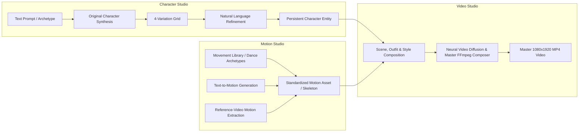

# 01. Original Product Vision & Architectural Mandate

**Product Name**: Auravo Studio  
**Tagline**: Autonomous AI Character Creation & Video Generation Platform  
**System Scope**: Three Interconnected Creative Studios (Character Studio, Motion Studio, Video Studio)  
**Document Status**: Canonical Alignment Specification (Phase 1A)  

---

## 1. Definitive Auravo Product Vision

Auravo Studio is an **AI-powered character creation and video generation platform**.

It empowers non-technical creators, artists, digital producers, and media teams to create original virtual characters, endow them with dynamic physical motion and choreography, and generate broadcast-quality video content featuring those characters across varied cinematic scenes.

---

## 2. The Three Interconnected Studios

### Studio A: Character Studio
The creative birthplace of virtual personalities.

1. **Text-First Character Creation**:
   - The user describes a character in plain text (e.g., *"A 24-year-old classical Indian dancer with sharp almond hazel eyes, high cheekbones, disciplined posture, wearing a gold-embroidered midnight emerald silk anarkali"*).
   - **No photograph upload is required.** The default experience generates 100% original, fictional synthetic humans.
2. **Variation Matrix**:
   - The system generates 4 distinct variations differing in facial symmetry, lighting, and wardrobe detail while adhering strictly to the textual prompt.
3. **Natural-Language Refinement**:
   - The user can iteratively tweak candidate characters (e.g., *"Make her expression more intense"*, *"Change the saree trim to silver temple zari"*, *"Soften the jawline"*).
4. **Approval & Reusable Identity Persistence**:
   - Once approved, the character is saved with unique **Identity Tokens**, facial embeddings/reference sheets, and generation seed metadata in SQLite.
   - The character is instantly available across future video projects without re-prompting.
5. **Optional Reference-Image Ingestion**:
   - Users may provide an optional reference photo or concept art, but this is strictly an auxiliary mode, never a gatekeeper for creation.
6. **Originality & Provenance Safeguards**:
   - Active filtering against reproducing real celebrities, public figures, or non-consensual real-person likenesses.
   - All characters are tagged with generation provenance and synthetic media metadata.

---

### Studio B: Motion Studio
The movement and choreography laboratory.

The user can animate their approved characters through three distinct movement pathways:

1. **Movement Library (Predefined Archetypes & Poses)**:
   - Curated motion bank covering classical dance mudras, Bollywood choreography, modern street dance, subtle acting gestures, runway walks, and emotional poses.
   - Parameterized controls for tempo, intensity, and duration (3s to 15s).
2. **Text-to-Motion Generation**:
   - The user describes choreography in natural language (e.g., *"Perform a swift kathak pirouette followed by a dramatic freeze with eyes gazing over the left shoulder"*).
   - Generates motion parameters without requiring video capture.
3. **Reference-Video Motion Extraction (Pose Retargeting)**:
   - The user uploads a video of a real dancer or physical movement.
   - The system extracts the **movement, skeletal poses, and spatial dynamics** (via pose estimation).
   - **Crucial Principle**: The system transfers the *motion*, strictly discarding the original human's facial appearance, skin, clothing, and background. The motion is retargeted onto the synthetic fictional character.

---

### Studio C: Video Studio
The master production and rendering engine.

Users assemble characters, motion, scenes, and audio into final cinematic reels:

1. **Character-Based & Text-to-Video Workflows**:
   - Supports both character-driven narratives and standalone text-to-video scene generation.
2. **Scene, Outfit, Camera & Style Controls**:
   - Custom visual staging: dramatic stage spotlighting, monsoon rain, neoclassical ballroom, neon cyber-stage, or outdoor architectural ruins.
   - Multi-angle camera direction (medium intro, tight facial close-up, dynamic wide shot, dramatic climax).
3. **Audio & Rhythmic Synchronization**:
   - Background score layering (original instrumental music, ambient score).
   - Synchronized voice narration / speech (TTS).
   - Auto-timed subtitles with mobile-optimized formatting.
4. **Interactive Review & 1-Click Master Export**:
   - Fast scene preview, beat-by-beat regeneration, and master 1080x1920 (9:16) H.264 MP4 export via high-performance FFmpeg rendering.

---

## 3. Core Target Audience & Use Cases

| User Persona | Primary Workflow | Key Value Proposition |
|---|---|---|
| **Virtual Influencer Creators** | Creates a consistent fictional persona; generates weekly dance and lifestyle reels. | Eliminates the need for 3D modeling rigs (Blender/Maya) or expensive camera crews. |
| **Social Media & Music Producers** | Creates high-energy music videos and rhythm reels paired with original music tracks. | Automated beat alignment, camera motion, and cinematic lighting in minutes. |
| **Choreographers & Dance Educators** | Tests and visualizes dance routines using virtual characters and reference video uploads. | Safe, rapid choreography prototyping without physical studio booking. |
| **Creative Agencies & Storytellers** | Produces multi-scene episodic fictional series with persistent character casts. | Maintains exact character facial and wardrobe consistency across 10+ episodes. |

---

## 4. Non-Negotiable Product Principles

1. **Originality Over Copying**: The platform creates original fictional characters. It is not an identity-theft or deepfake face-swapping service.
2. **Usability Over Technical Jargon**: Users should not need to understand diffusion steps, CFG scales, LoRA rank, or VRAM offloading. Intuitive visual cards and sliders replace raw machine learning parameters.
3. **Zero-API-Lock-In Core**: The system must maintain a high-quality local fallback rendering pipeline (local FFmpeg + CPU procedural synthesis) so the core software remains usable and testable even without expensive cloud GPUs.
4. **Modular Capability-Based Architecture**: Character synthesis, motion extraction, and video generation must use clean provider interfaces so underlying AI models (Stable Diffusion, Flux, LivePortrait, MimicMotion, Wan2.1, Kling, Runway) can be upgraded without refactoring business logic.

