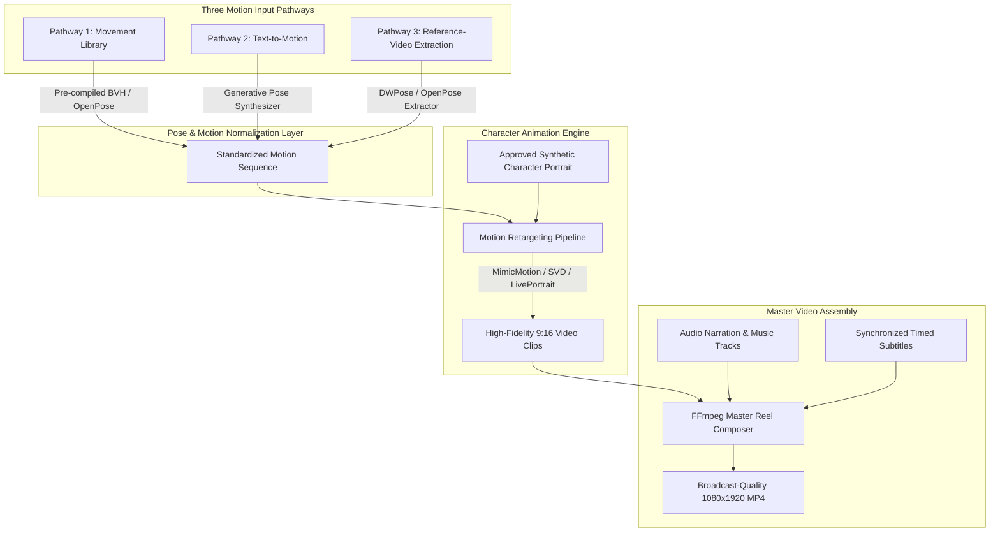

# 05. Motion & Video Generation Architecture

**Audit Date**: November 2026  
**System**: Auravo Studio — Motion Studio & Video Studio Architecture  
**Scope**: Movement Presets, Pose Extraction, Motion Retargeting, and Video Diffusion  

---

## 1. The Three Motion Pathways Architecture



---

## 2. Deep Dive into the Motion Pathways

### Pathway 1: Movement Library (Curated Archetypes & Poses)
- **Current State in Repo**:
  - `server/providers/dance_motion.ts` implements 5 procedural 30fps camera movements anchored on eye-lines (Intro Hook, Mudra Flow, Lateral Stage Glide, Climax Pull-Out, Graceful Bow).
  - `DANCER_ARCHETYPES` define signature moves (e.g., *"Thumka Pirouette"*, *"Monsoon Cloud Arches"*, *"Flamenco Zapateado"*).
- **Target Upgrade**:
  - Complement camera zoom with **pre-rendered skeletal pose sequences** (OpenPose JSON format).
  - A user selects "Kathak Chakkar Spin" or "Hip-Hop Bounce"; the system feeds the pre-extracted skeleton sequence into the motion retargeting engine, applying full physical body movement to the character.

### Pathway 2: Text-to-Motion
- **Current State in Repo**:
  - In `server/providers/dance_motion.ts`, text prompts select fixed camera filters or forward text to remote SVD.
- **Target Upgrade**:
  - Phase 1: Curated natural-language mapping (e.g., recognizing keywords like "pirouette", "jump", "glide", "bow") and linking them to calibrated pose sequences.
  - Phase 2: Integration with dedicated text-to-motion generative models (such as MDM - Motion Diffusion Model or MotionGPT) that output 3D skeletal data from text.

### Pathway 3: Reference-Video Motion Extraction (Pose Retargeting)
- **Current State in Repo**:
  - `server/content_engine.ts:880–940` downloads the user's video, cuts it into 5 slices with FFmpeg, and directly plays the physical video in the scene.
- **Architectural Defect**:
  - The synthetic character is completely replaced by the real human in the reference video!
- **Target Replacement**:
  1. **Pose Extraction**: Run the reference video through **DWPose** (or OpenPose). This extracts the skeletal coordinates for every frame (body joints, hands, feet, facial landmarks), completely stripping away the original dancer's face, clothing, and background.
  2. **Motion Retargeting**: Feed the extracted skeleton sequence and the **approved synthetic character portrait** into a motion-conditioned video generator (**MimicMotion** or **Champ**).
  3. **Result**: The user's virtual character executes the exact physical choreography of the reference video while retaining 100% of their synthetic identity.

---

## 3. Video Studio: Neural Video Diffusion & Master Composition

### 3.1 Two Video Generation Modes
1. **Character-Based Video**:
   - The user selects an approved character from Character Studio.
   - The character is placed into a chosen scene, outfit, and motion sequence.
   - The engine generates a video maintaining identity continuity across beats.
2. **General Text-to-Video**:
   - The user enters a direct scene description (e.g., *"Drone shot rising over an ancient temple bathed in golden sunset mist"*).
   - Generates standalone cinematic B-roll or background footage without character anchoring.

### 3.2 Dual-Engine Video Synthesis Stack

| Engine Layer | Technology | Primary Function | Cost / Compute |
|---|---|---|---|
| **Facial & Vocal Engine** | **LivePortrait** | Drives natural eye blinks, facial expressions, and lip synchronization to narration or singing. | Ultra-fast (<1s per frame on T4 GPU). Runs locally or via Colab/Kaggle worker. |
| **Full-Body Motion Engine** | **MimicMotion / SVD-XT** | Takes character reference image + skeletal motion sequence; outputs continuous body choreography. | 15–30s per 3-second clip on T4 GPU; 5s on A10G/L4. |
| **Procedural Fallback** | **FFmpeg Filter Chains** | High-precision 30fps Ken Burns pan, zoom, and framing presets. | **₹0.00 / 0.2s on standard CPU**. Ensures system never fails if GPUs are offline. |
| **Master Compositor** | **FFmpeg CLI Engine** | Multi-scene concat, audio mixing (`amix`), resolution scaling (1080x1920), H.264/AAC encoding. | **100% Local / Free**. Broadcast quality master reels. |

---

## 4. Proposed Pluggable Provider Architecture

To avoid vendor lock-in, all video and motion engines are abstracted behind strict TypeScript interfaces in `server/providers/types.ts`:

```typescript
export interface MotionExtractionProvider {
  extractPoseSequence(videoPath: string): Promise<{ poseDataPath: string; frameCount: number }>;
}

export interface MotionRetargetProvider {
  animateCharacterWithPose(options: {
    characterImagePath: string;
    poseDataPath: string;
    durationSec: number;
    outputPath: string;
  }): Promise<{ videoPath: string; durationSec: number }>;
}

export interface TextToVideoProvider {
  generateSceneVideo(prompt: string, durationSec: number, outputPath: string): Promise<{ videoPath: string }>;
}
```

This ensures that whether Auravo uses a local Python worker (ComfyUI / MimicMotion), Google Colab, or hosted commercial APIs (Kling, Runway, Luma), the core business and user workflows remain identical.

