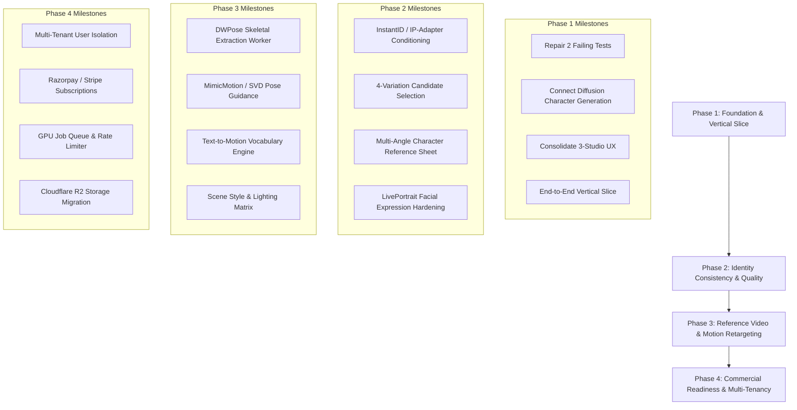

# 09. Phased Implementation Roadmap & Engineering Milestones

**Audit Date**: November 2026  
**System**: Auravo Studio  
**Scope**: Phased Roadmap from Foundation to Commercial Multi-Tenant Studio  

---

## 1. Roadmap Architecture Overview

---

## 2. Phase-by-Phase Technical Specifications

### Phase 1: Foundation & Functional Vertical Slice
- **Primary Objective**: Repair existing regressions, establish working communication between Node.js and the Python AI worker for character creation, consolidate the 3-studio interface, and achieve a working end-to-end vertical slice.
- **User-Visible Outcome**: A user enters a character description, generates an original AI character portrait, selects a motion preset from the Movement Library, and exports a finished 1080x1920 MP4 reel.
- **Modules & Files Likely to Change**:
  - `server/content_engine.ts` (Fix `audioMode` default; connect character generation).
  - `server/providers/character_gen.ts` (Implement real fallback diffusion or API connection).
  - `ai_worker/main.py` (Add missing `/api/generate-character` route for SDXL-Lightning / Flux).
  - `web/main.tsx` (Organize into Character Studio, Motion Studio, Video Studio tabs).
- **Dependencies**: Node.js 20+, FFmpeg 8.x, Colab / Kaggle T4 worker running `ai_worker/main.py`.
- **Risks**: Cloudflare tunnel instability during development testing.
- **Acceptance Criteria**:
  1. `npm test` runs with **17 / 17 tests passing (100%)**.
  2. Character Studio generates an original portrait from text prompt without errors.
  3. Master FFmpeg export renders a synchronized 1080x1920 MP4 video in under 20 seconds.
- **Priority**: **P0 (Immediate)** | **Complexity**: Medium (3–4 engineering days).

---

### Phase 2: Identity Consistency & Multi-Variation Generation
- **Primary Objective**: Implement zero-shot facial identity conditioning (InstantID or IP-Adapter-FaceID) and multi-variation candidate selection.
- **User-Visible Outcome**: User types a prompt, sees a 4-variation thumbnail grid, selects the winning face, and can generate multi-angle scene artwork maintaining that exact character identity.
- **Modules & Files Likely to Change**:
  - `server/providers/character_gen.ts` (Add 4-seed batch generation and InstantID vector caching).
  - `ai_worker/main.py` (Load InstantID / IP-Adapter weights on worker GPU).
  - `web/components/CharacterStudio.tsx` (Render 4-variation selection UI).
- **Dependencies**: Phase 1 completion, 16GB VRAM GPU.
- **Risks**: VRAM exhaustion on T4 GPU when switching between LivePortrait and InstantID (requires sequential VRAM GC).
- **Acceptance Criteria**:
  1. User can choose between 4 candidate faces in under 8 seconds.
  2. Character identity maintains >85% facial cosine similarity across 5 different scene angles.
- **Priority**: **P1** | **Complexity**: High (5–7 engineering days).

---

### Phase 3: Reference Video Extraction & Motion Retargeting
- **Primary Objective**: Replace raw reference-video slicing with true pose estimation (DWPose) and motion retargeting (MimicMotion / SVD pose conditioning).
- **User-Visible Outcome**: User uploads a dance video; the system extracts the physical dance routine and makes their *approved virtual character* perform the exact movements, completely removing the original person.
- **Modules & Files Likely to Change**:
  - `server/providers/dance_motion.ts` (Add pose-data ingestion).
  - `server/content_engine.ts` (Replace raw slicing with DWPose worker dispatch).
  - `ai_worker/main.py` (Implement DWPose extraction + MimicMotion inference pipeline).
  - `web/components/MotionStudio.tsx` (Dedicated motion previewer and skeletal skeleton player).
- **Dependencies**: Phase 2 completion, DWPose ONNX runtime, PyTorch diffusers.
- **Risks**: Long inference time for 15s video on T4 GPU (up to 3–4 minutes per clip).
- **Acceptance Criteria**:
  1. Reference video upload extracts clean 30fps OpenPose coordinates.
  2. Output video displays synthetic character performing the uploaded dance choreography without facial or limb melting.
- **Priority**: **P1** | **Complexity**: Very High (7–10 engineering days).

---

### Phase 4: Commercial Multi-Tenancy & Production Hardening
- **Primary Objective**: Transform the working single-tenant prototype into a secure, multi-tenant SaaS platform with billing, quotas, and automated cloud infrastructure.
- **User-Visible Outcome**: Public self-service user registration, tiered credit allowances, Stripe / Razorpay checkout, and personal project history.
- **Modules & Files Likely to Change**:
  - `server/app.ts` (Remove single-owner lock; enforce tenant isolation).
  - `server/migrations/007_subscriptions.sql` (Add subscriptions and quota tracking).
  - `server/jobs.ts` (Decouple all rendering to Redis / SQLite worker queue with rate limits).
  - `web/components/BillingModal.tsx` (Subscription management and plan selector).
- **Dependencies**: Razorpay / Stripe merchant keys, cloud storage bucket (Cloudflare R2).
- **Risks**: Managing concurrent GPU rendering spikes across multiple paying users.
- **Acceptance Criteria**:
  1. User B cannot view or access User A's characters, scripts, or video files.
  2. Quotas automatically deduct upon video export; rendering blocks when monthly allowance is reached.
  3. Webhook successfully activates paid subscription upon payment.
- **Priority**: **P2** | **Complexity**: Medium-to-High (6–8 engineering days).

