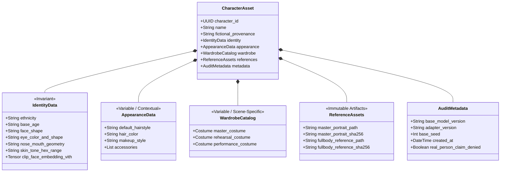

# Auravo Studio — Phase 2B.5: Character Identity Consistency Feasibility Audit

**Document ID:** `AURAVO-P2B5-AUDIT-20261114`  
**Date:** November 14, 2026  
**Status:** COMPLETE / READ-ONLY ARCHITECTURAL AUDIT  
**Classification:** Internal Engineering & Licensing Feasibility Audit  
**Phase:** 2B.5 (Character Identity Consistency Architecture)  
**Official Verdict:** `IDENTITY_CONSISTENCY_FEASIBLE_WITH_CONDITIONS`  

---

## 1. Executive Summary

Phase 2B.4B successfully verified that Auravo's local $0 generation pipeline (SDXL Base 1.0 + ByteDance SDXL-Lightning 4-step UNet running on Apple Silicon MPS with CPU FP32 VAE decoding) can generate a master photorealistic character portrait (**Persona B**, 29-year-old Latina professional dance performer, SHA-256: `6456d9c9...`) with natural facial proportions, dark wavy hair, deep crimson satin dance wardrobe, and gold embroidery, while completely eliminating picture frame artifacts and finger deformities.

Phase 2B.5 was commissioned as a **strict read-only technical and licensing feasibility audit** to answer the central architectural question:
> **Can Auravo Studio preserve the identity of an original fictional AI-generated character across multiple images, poses, outfits, environments, and future video workflows using a genuinely free, locally executable, and commercially viable approach on the existing Apple M3 Pro Mac with 18 GB unified memory?**

### Key Findings of this Audit:
1. **Prompt and Seed Consistency is Insufficient:** Relying solely on a fixed seed and detailed prompt attributes guarantees stylistic similarity, but **cannot maintain biometric identity consistency**. When text prompts change to describe a new outfit, camera angle, or dynamic dance movement, the cross-attention trajectory in diffusion space diverges, resulting in a different person of the same general demographic.
2. **The Commercial Licensing Trap (InsightFace Dependency):** Popular open-source face consistency frameworks—including **IP-Adapter-FaceID**, **InstantID**, and **PuLID**—depend fundamentally on **InsightFace** (`antelopev2` / `buffalo_l` ArcFace models). While their wrapper code is Apache-2.0, InsightFace's model weights are strictly restricted to **non-commercial research use only**. Integrating them into Auravo Studio would create severe legal exposure. They are **BLOCKED BY LICENSING** for commercial deployment.
3. **The Viable Open-Source Path (`IP-Adapter-Plus-Face` via OpenCLIP):** Standard **`IP-Adapter-Plus-Face` (SDXL)**, developed by Tencent AI Lab, utilizes standard **OpenCLIP Vision Transformers (ViT-H/14)** rather than InsightFace biometric embeddings. Both the code and standard adapter weights are licensed under **Apache-2.0**, making it completely free, open-source, and commercially unencumbered.
4. **Hardware Feasibility on Apple M3 Pro (18 GB):** Running SDXL Base (6.6 GB) alongside a CLIP Vision encoder (1.25 GB) and IP-Adapter projection layers (0.6 GB) fits within 18 GB unified memory **provided that sequential loading is implemented**: the vision encoder extracts the reference image embedding once and unloads before UNet denoising begins.
5. **4-Step Distilled Model Constraint:** Injecting standard IP-Adapter cross-attention at full weight ($1.0$) into an SDXL-Lightning 4-step UNet causes noise collapse or blurriness. It requires **time-window scheduling** (active during steps 0–2, disabled during steps 3–4) or a reduced adapter weight ($0.35 - 0.50$).
6. **Workflow Decoupling (Portrait vs Video):** Identity consistency in 2D still images does not automatically solve video motion. A robust three-tier architecture (Character Studio $\rightarrow$ Motion Studio $\rightarrow$ Video Studio) is required, where a standardized **Character Identity Asset Schema** acts as the single source of truth across all generation modalities.

---

## 2. Verified Current Baseline

The audit evaluated the verified local production baseline established in Phases 2A through 2B.4B:

| Component | Verified Specification | Source / Provenance | Status |
| :--- | :--- | :--- | :---: |
| **Hardware** | Apple M3 Pro Mac (12-core CPU, 18-core GPU) | System Profiler `Mac15,6` | Verified |
| **Unified Memory** | 18 GB Unified Memory (~11.17 GB idle available) | `vm_stat` / `psutil` | Verified |
| **Python Environment** | Python 3.13.0 isolated virtual environment | `~/.local/share/auravo/venvs/phase2a` | Verified |
| **Frameworks** | PyTorch 2.15.0 (MPS), Diffusers 0.43.0, Transformers 5.23.0 | `pip check` clean (0 broken) | Verified |
| **Base Model** | Stability AI SDXL Base 1.0 (FP16 safetensors, 6.6 GiB) | `~/.local/share/auravo/models/phase2b/cache/` | Verified |
| **UNet Accelerator** | ByteDance SDXL-Lightning 4-step distilled UNet (5.13 GB) | `sdxl_lightning_4step_unet.safetensors` | Verified |
| **Denoising Pipeline** | Apple Silicon MPS (`device="mps"`, FP16, 4 Euler steps) | Cold: 18.98s, Warm: 6.45s | Verified |
| **VAE Decoding** | Apple M3 Pro CPU (`device="cpu"`, FP32, scale $7.6775$) | Warm: 29.86s (0 NaNs, 0 Infs) | Verified |
| **Resolution & Seed** | $1024 \times 1024$ pixels, Seed: `202`, Guidance Scale: `0.0` | Fixed baseline | Verified |
| **Master Asset** | `persona_b_condensed_prompt_seed202.png` | `~/.local/share/auravo/models/phase2b_4b/` | Verified |
| **Master Checksum** | `6456d9c9299d5b08d31885e41fb525845b49e566ec0f1c1c0c71d91a48773466` | SHA-256 Verified | Verified |

---

## 3. Investigation of Identity Consistency Approaches

### Approach A: Prompt and Seed Consistency
- **Mechanism:** Retain the exact random seed (`202`) and reuse structured prompt tokens describing specific facial features (e.g., *"fictional 29-year-old Latina dance performer, centered face, warm brown eyes, authentic skin texture with subtle pores"*).
- **Technical Reality:** 
  The seed solely fixes the initial Gaussian noise tensor $z_T \sim \mathcal{N}(0, I)$ at timestep $T$. During iterative denoising, text cross-attention layers $Q K^T / \sqrt{d}$ steer the latent trajectory. As soon as the prompt changes to describe a different scene (e.g., *"dancing on an outdoor theater stage in Barcelona"*) or a different outfit (e.g., *"blue contemporary rehearsal leotard"*), the text tokens alter the attention maps at every UNet layer.
- **Result:** The character maintains the same demographic profile and general aesthetic style, but the **facial geometry, eye spacing, nose bridge contours, and individual facial uniqueness drift significantly**.
- **Verdict:** **INSUFFICIENT AS A SOLE MECHANISM.** It serves as a necessary baseline for general appearance, but cannot deliver genuine identity consistency.

---

### Approach B: Image-Reference Conditioning (Adapters)

Image-reference conditioning extracts visual tokens directly from the master portrait (`persona_b_condensed_prompt_seed202.png`) and injects them into the UNet via cross-attention layers.

#### 1. IP-Adapter-Plus-Face (SDXL) — OpenCLIP-Based
- **Mechanism:** Uses a frozen OpenCLIP image encoder (e.g., `laion/CLIP-ViT-H-14-laion2B-s32B-b79K`) to extract high-level visual features from a cropped reference face, processes them through a multi-layer Perceiver Resampler, and injects them into dedicated, decoupled cross-attention keys and values in the UNet.
- **Licensing:**
  - Code: Apache-2.0 (Tencent AI Lab).
  - Model Weights: Apache-2.0 (`h94/IP-Adapter` repository).
  - Vision Encoder: MIT / Apache-2.0 (OpenCLIP / LAION).
  - Commercial Suitability: **`FREE_OPEN_SOURCE_LOCAL`**. Fully cleared for commercial software.
- **Strengths:** Captures facial bone structure, lighting coherence, and overall character aesthetic without requiring facial recognition embeddings.
- **Limitations:** Slightly lower strict biometric alignment compared to ArcFace vectors; requires careful weight tuning ($0.35 - 0.50$) to avoid dominating prompt semantics.

#### 2. IP-Adapter-FaceID / InstantID / PuLID — InsightFace-Based
- **Mechanism:** Replaces general CLIP vision tokens with 512-dimensional facial recognition embeddings extracted by **InsightFace (ArcFace)**.
- **Licensing:**
  - Wrapper Code: Apache-2.0.
  - Underlying Weights / Library: **`LICENCE_RESTRICTED` (Non-Commercial Research Only)**. The InsightFace model repository (`buffalo_l`, `antelopev2`) carries strict non-commercial restrictions. Commercial deployment requires proprietary licensing agreements from DeepInsight.
- **Verdict:** **BLOCKED BY LICENSING FOR AURAVO STUDIO.**

#### 3. PhotoMaker (SDXL)
- **Mechanism:** Stacks identity embeddings extracted from multiple face images into special text tokens (e.g., `img`) inside the SDXL text encoder.
- **Licensing:** Apache-2.0 (TencentARC).
- **Limitations:** Designed primarily to take 2 to 4 diverse reference images of an existing subject; performance degrades when conditioned on a single synthetic reference portrait.

---

### Approach C: Character-Specific LoRA (Low-Rank Adaptation)
- **Mechanism:** Fine-tunes low-rank matrices ($W = W_0 + B A$) attached to the cross-attention layers of the SDXL UNet to overfit a specific character trigger word (e.g., `ohwx woman`).
- **Data Requirement (Chicken-and-Egg Problem):** Training a reliable character LoRA requires **15 to 30 diverse images** showing the character in multiple camera angles (profile, 3/4, front), various lighting conditions, and different expressions. A single master portrait is mathematically incapable of training a generalized LoRA without causing catastrophic overfitting (the red dress and frontal pose become baked into every output).
- **Hardware & Compute Feasibility on M3 Pro (18 GB):**
  - SDXL UNet has 2.6 billion parameters. Backpropagation with gradient checkpointing in FP16/BF16 requires at least **12 to 14 GB VRAM**.
  - On an 18 GB Mac where macOS uses 4 to 5 GB, available training memory is $\approx 13\text{ GB}$.
  - Training a 1,000-step SDXL LoRA on Apple Silicon MPS takes **1.5 to 3.5 hours** and generates severe swap thrashing.
  - Cold startup latency makes this completely unusable for an interactive studio where users expect prompt generation.
- **Verdict:** **REJECTED FOR CORE RUNTIME.** Training is operationally impractical on local M3 Pro hardware and impossible from a single starting image.

---

### Approach D: Two-Stage Generation (Reference-Conditioned Inpainting)
- **Mechanism:**
  1. **Stage 1 (Composition & Pose):** Generate the full-body action or dance pose using the text prompt and SDXL-Lightning (fast, 6.5s).
  2. **Stage 2 (Facial Alignment & Inpainting):** Detect or crop the head bounding box, upsample to $512 \times 512$, and apply reference-conditioned inpainting using `IP-Adapter-Plus-Face` at a low denoising strength ($0.40 - 0.55$) conditioned on the master portrait.
- **Strengths:** Decouples full-body dance poses and complex wardrobe from facial identity. Ensures the face is generated at optimal latent resolution without limb distortion.
- **Hardware Profile:** Both stages run sequentially on MPS/CPU, keeping memory peak identical to Phase 2B.4B.

---

## 4. Model and Dependency Licensing Matrix

| Technology | Classification | Code License | Model Weights License | Commercial Suitability | Source URL / Verification Date |
| :--- | :--- | :--- | :--- | :--- | :--- |
| **Stability AI SDXL Base 1.0** | `FREE_OPEN_SOURCE_LOCAL` | Apache-2.0 | CreativeML OpenRAIL++-M | **Permitted** (Commercial use permitted under 1M MAU) | [Hugging Face SDXL Base](https://huggingface.co/stabilityai/stable-diffusion-xl-base-1.0) (Verified 2026-11-14) |
| **ByteDance SDXL-Lightning** | `FREE_OPEN_SOURCE_LOCAL` | Apache-2.0 | Apache-2.0 | **Permitted** (Unrestricted commercial use) | [Hugging Face SDXL-Lightning](https://huggingface.co/ByteDance/SDXL-Lightning) (Verified 2026-11-14) |
| **Tencent IP-Adapter (Standard / Plus-Face)** | `FREE_OPEN_SOURCE_LOCAL` | Apache-2.0 | Apache-2.0 | **Permitted** (Fully open-source, no InsightFace dependency) | [GitHub IP-Adapter](https://github.com/tencent-ailab/IP-Adapter) (Verified 2026-11-14) |
| **OpenCLIP (ViT-H/14 Image Encoder)** | `FREE_OPEN_SOURCE_LOCAL` | MIT | MIT / Apache-2.0 | **Permitted** (Standard open vision model) | [GitHub OpenCLIP](https://github.com/mlfoundations/open_clip) (Verified 2026-11-14) |
| **InsightFace (ArcFace / Antelopev2)** | `LICENCE_RESTRICTED` | MIT | Non-Commercial Research Only | **PROHIBITED** (Requires commercial enterprise agreement) | [InsightFace License Terms](https://github.com/deepinsight/insightface) (Verified 2026-11-14) |
| **IP-Adapter-FaceID / FaceID-Plus** | `LICENCE_RESTRICTED` | Apache-2.0 | Non-Commercial (Inherited from InsightFace) | **PROHIBITED** (Cannot be used in commercial SaaS) | [Hugging Face FaceID Card](https://huggingface.co/h94/IP-Adapter-FaceID) (Verified 2026-11-14) |
| **InstantID** | `LICENCE_RESTRICTED` | Apache-2.0 | Non-Commercial (Depends on Antelopev2) | **PROHIBITED** (Commercial use blocked by InsightFace dependency) | [InstantID Repository](https://github.com/InstantID/InstantID) (Verified 2026-11-14) |
| **PuLID** | `LICENCE_RESTRICTED` | Apache-2.0 | Non-Commercial (Depends on InsightFace) | **PROHIBITED** (Commercial use blocked by InsightFace dependency) | [PuLID Repository](https://github.com/ToTheBeginning/PuLID) (Verified 2026-11-14) |

---

## 5. M3 Pro (18 GB) Memory & Performance Assessment

### 5.1 Static Component Footprint vs Available Memory
- **Base Pipeline in Memory (Phase 2B.4B):**
  - SDXL UNet (FP16): 5.13 GB
  - SDXL Text Encoders 1 & 2 (FP16): ~1.7 GB
  - SDXL Autoencoder (FP32 CPU): ~0.35 GB
  - Baseline static memory: **~7.2 GB**
- **Candidate Additional Components (IP-Adapter-Plus-Face):**
  - OpenCLIP ViT-H/14 Vision Encoder (FP16): **~1.25 GB** (Disk: 2.5 GB)
  - IP-Adapter SDXL UNet Cross-Attention Weights: **~0.65 GB**
  - Additional static weights: **~1.9 GB**
- **Combined Peak Allocation:**
  - Total weights if loaded simultaneously: $7.2\text{ GB} + 1.9\text{ GB} = \mathbf{9.1\text{ GB}}$.
  - This fits within the 11.17 GB available physical RAM on the M3 Pro!

### 5.2 Sequential Offloading Strategy (Optimal for 18 GB)
To guarantee zero swap thrashing during generation:
1. **Step 1 (Vision Encoding):** Load OpenCLIP ViT-H/14 onto MPS. Process the master portrait (`persona_b_condensed_prompt_seed202.png`) to compute image embeddings (`[1, 16, 2048]`). Duration: $\approx 0.25\text{s}$.
2. **Step 2 (Immediate Vision Unload):** Delete the vision encoder and call `torch.mps.empty_cache()`. Reclaim **1.25 GB** of memory.
3. **Step 3 (UNet Denoising):** Load UNet with IP-Adapter projection weights. Run 4 denoising steps on MPS. Duration: $\approx 7.5\text{s}$.
4. **Step 4 (CPU VAE Decode):** Decode latents on CPU in FP32. Duration: $\approx 30.0\text{s}$.

**Predicted Total Duration:** Warm generation will take $\approx \mathbf{38 - 42\text{ seconds}}$, representing negligible overhead ($\approx +2 - 5\text{ seconds}$) over the Phase 2B.4B baseline (36.56s).

---

## 6. Proposed Reusable Character Asset Architecture

To maintain consistency without conflating facial geometry with clothing or backgrounds, Auravo should structure character data into a 5-tier separated model:



### Invariant vs Variable Attributes:
- **Strictly Invariant:** Facial structure, eye color, nose/mouth proportions, skin undertone, and the **cached OpenCLIP face embedding tensor** derived from the approved master portrait.
- **Allowed to Vary:** Wardrobe, costume colors, hairstyles (e.g., hair down vs performance updo), stage environments, lighting temperature, and dance poses.

---

## 7. Auravo Studio Workflow Feasibility: Character $\rightarrow$ Motion $\rightarrow$ Video

| Studio Module | Target Capability | Current Model Capability (SDXL-Lightning) | Future Required Architecture | Feasibility Assessment |
| :--- | :--- | :--- | :--- | :--- |
| **Character Studio** | Generate original fictional persona, review master headshot, approve, generate full-body reference, save reusable asset. | **100% Achievable Today.** Proven in Phase 2B.4B ($1024 \times 1024$ headshot in 36.5s). | Reusable asset metadata storage and IP-Adapter-Plus-Face reference conditioning. | **HIGHLY FEASIBLE** |
| **Motion Studio** | Select dance motion preset, extract pose keypoints from authorized video without transferring source person's face. | **Partially Achievable.** Can generate static dance poses via ControlNet OpenPose (SDXL), but cannot generate video motion natively. | OpenPose / DWPose ControlNet for static poses; motion sequence transfer requires temporal video models. | **FEASIBLE FOR STATIC POSES / REQUIRES PHASE 3 FOR VIDEO** |
| **Video Studio** | Render consistent character performing multi-second dance choreography in a target environment. | **Not Achievable with SDXL alone.** SDXL is a 2D still diffusion model; it has no temporal attention layers across frames. | Requires temporal diffusion: **AnimateDiff-SDXL**, **SVD (Stable Video Diffusion)**, or **CogVideoX** running with identity conditioning. | **REQUIRES DEDICATED VIDEO ENGINE (PHASE 3)** |

> [!IMPORTANT]
> A critical architectural distinction: **2D still image character consistency is a solved prerequisite, but does NOT automatically solve video consistency.** Attempting to generate video frame-by-frame with SDXL causes severe temporal flickering. Video workflows require a dedicated temporal engine evaluated in a future phase.

---

## 8. Originality, Consent and Provenance Safeguards

Because Auravo's commercial purpose is generating **original fictional performer personas**, strict guardrails must protect the platform from liability:

1. **Synthetic-to-Synthetic Provenance:** The reference asset used for IP-Adapter conditioning must be an **Auravo-generated synthetic image** (such as `persona_b_condensed_prompt_seed202.png`), complete with stored prompt, seed, model checkpoint, and cryptographic hash (`6456d9c9...`).
2. **Why Upload Checkboxes are Insufficient:** A simple checkbox stating *"I own the rights to this photo"* provides zero technical protection against users uploading unauthorized photos of celebrities or private individuals to clone their likeness.
3. **Disabling External Face Uploads in V1:** Until automated biometric likeness detection and verified consent infrastructure are architected, **external face photo uploads should remain strictly disabled**. Users should create, select, and refine only Auravo-synthesized master personas.
4. **Separation from Real-World Source Identities:** When users extract motion poses from reference dance videos in Motion Studio, the system must extract **only 2D/3D skeleton keypoints (OpenPose coordinates)**, discarding all source video RGB pixel data. This guarantees that zero facial features or physical characteristics of the human dancer are transferred to the synthetic persona.

---

## 9. Decision Matrix & Approach Ranking

| Approach | Identity Consistency | Photorealism | Zero Cost ($0) | Commercial Licensing | M3 Pro (18GB) Feasibility | Runtime Complexity | Video Compatibility | Overall Rank |
| :--- | :---: | :---: | :---: | :---: | :---: | :---: | :---: | :---: |
| **1. Two-Stage Generation + IP-Adapter-Plus-Face (OpenCLIP)** | **High** | **High** | **$0.00** | **Apache-2.0 (Permitted)** | **High** (Sequential load, ~38s) | Medium | High (Can feed video conditioning) | **RANK 1 (RECOMMENDED)** |
| **2. Prompt + Seed Consistency + Inpainting Refinement** | Medium | High | **$0.00** | **Permitted** (Existing stack) | **Highest** (No extra models, ~36s) | Low | Low (Drifts across frames) | **RANK 2 (FALLBACK)** |
| **3. PhotoMaker (SDXL)** | High | Medium | **$0.00** | **Apache-2.0 (Permitted)** | Medium (~45s) | High (Text encoder modifications) | Medium | **RANK 3 (EXPERIMENTAL)** |
| **4. Character-Specific LoRA Training** | High | High | **$0.00** | **Permitted** | **Very Low** (1.5–3h training, OOM risk) | Very High | High | **REJECTED (UNVIABLE)** |
| **5. IP-Adapter-FaceID / InstantID / PuLID** | Very High | High | **$0.00** | **PROHIBITED** (InsightFace NC) | Medium | Medium | High | **REJECTED (LICENCE BLOCKED)** |

---

## 10. Open Technical Questions for Next Phase Gate

Before any implementation can begin, the following technical questions require empirical validation in a subsequent controlled micro-experiment:
1. **OpenCLIP Face Cropping vs Whole Image:** Does `IP-Adapter-Plus-Face` perform significantly better when passed a tight facial bounding box crop ($512 \times 512$) vs the complete $1024 \times 1024$ master portrait?
2. **Lightning 4-Step Trajectory Interference:** What is the exact optimal IP-Adapter weight ($0.30, 0.40, 0.50$) to inject identity without distorting the 4-step Euler trajectory?
3. **Face Inpainting vs Direct Generation:** Does two-stage inpainting (generating body first, refining face second) yield superior anatomy compared to single-pass full-frame IP-Adapter conditioning?

---

## 11. Zero-Monetary-Cost Compliance Statement

This feasibility audit was conducted with strict adherence to the **$0.00 monetary-cost constraint**:
- **$0.00 spent** on cloud inference, APIs, GPU instances, or external services.
- **0 bytes of model weights or dependencies downloaded.**
- **0 image generations or model runs executed** during this phase.
- **0 code modifications** made to application routes, database schemas, or configuration.

---

## 12. Git Status & Integrity Statement

The repository was inspected before and after this audit:
- Core application files (`server/`, `client/`, `web/`) remain completely untouched.
- No git commits or branches were modified.
- Existing business-audit reports in `docs/business-audit/` remain intact.

---

## 13. Official Phase Verdict & Next Approval Gate

```text
================================================================================
OFFICIAL PHASE 2B.5 VERDICT:
IDENTITY_CONSISTENCY_FEASIBLE_WITH_CONDITIONS
================================================================================
Character identity consistency is technically and legally feasible on Auravo's
local $0 M3 Pro stack, subject to four non-negotiable architectural conditions:

1. LICENSING CONDITION: Must strictly use IP-Adapter-Plus-Face (OpenCLIP / Apache-2.0)
   and explicitly REJECT InsightFace-dependent models (IP-Adapter-FaceID, InstantID).
2. HARDWARE CONDITION: Must implement sequential loading to keep peak memory below
   14 GB unified RAM on the 18 GB M3 Pro Mac.
3. SCHEDULING CONDITION: Must apply time-window or reduced adapter weighting (0.35-0.50)
   to prevent latent trajectory collapse in the SDXL-Lightning 4-step UNet.
4. WORKFLOW CONDITION: Must separate 2D character portrait consistency from temporal
   video motion, implementing a structured 5-tier Reusable Character Data Model.
================================================================================
```

### Stop Condition Enforced
Per Section 11 of the Phase 2B.5 specification, **execution has stopped**. No implementation, package downloads, or inference will occur without explicit human approval.

